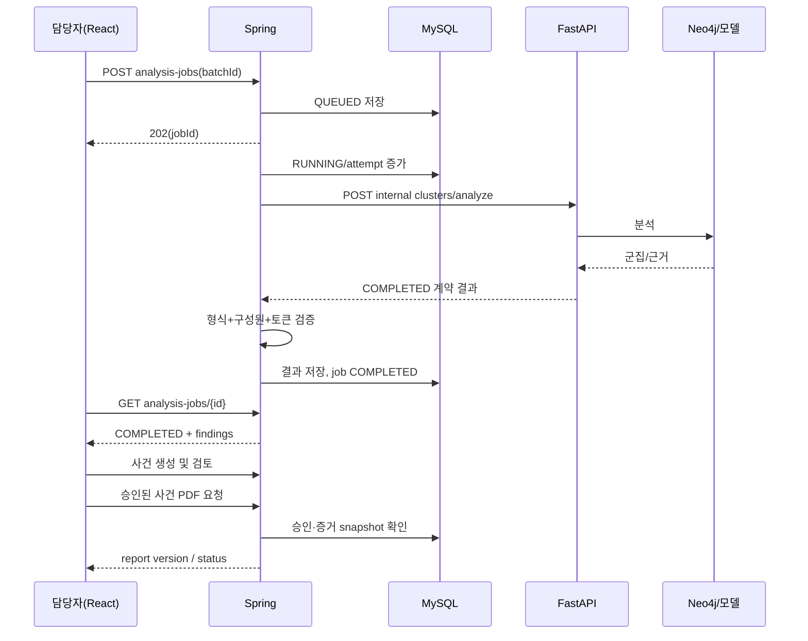

# 04. 사용자 시나리오·업무흐름·상태 전이

## 4계층 상태 모델 — 서로 합치지 말 것
1. `ImportBatch`: RECEIVED → VALIDATING → ACCEPTED 또는 REJECTED; ACCEPTED → ARCHIVED.
2. `AnalysisJob`: QUEUED → RUNNING → COMPLETED | RETRY_WAIT | FAILED | CANCELLED; RETRY_WAIT → QUEUED; FAILED → QUEUED(명시적 재실행, 새 attempt 기록). `COMPLETED`는 업무 승인 아님.
3. `FraudCase`: OPEN → TRIAGED → IN_REVIEW → NEEDS_EVIDENCE | READY_FOR_APPROVAL | DISMISSED; NEEDS_EVIDENCE → IN_REVIEW; READY_FOR_APPROVAL → APPROVED_FOR_REPORT | IN_REVIEW; APPROVED_FOR_REPORT → CLOSED; DISMISSED → CLOSED. CLOSED 이후에는 `REOPEN`을 감사 사유 포함한 명시적 새 이벤트로만 허용.
4. `ReportVersion`: DRAFT → PENDING_APPROVAL → APPROVED | REJECTED; APPROVED → RENDERING → GENERATED | GENERATION_FAILED; GENERATION_FAILED → RENDERING(버전/재시도 관리), GENERATED → SUPERSEDED(신규 버전 승인 시).

Track2 `ExtractionRun`: QUEUED → RUNNING → COMPLETED | FAILED; 각 **필드**의 상태는 `VISIBLE | ABSENT | UNREADABLE | AMBIGUOUS`, fieldValue는 뒤의 세 상태에서 기본적으로 null. 이미지 진위와 판매자 특정은 별도 판정 불가.

## 업무 시퀀스

## 상태별 프론트 액션 가드
| 대상/상태 | 표시 정보 | 가능한 버튼 | 금지 동작 |
|---|---|---|---|
| Import VALIDATING | 검증 진행률 | 새로고침 | 분석 시작 |
| Import ACCEPTED | 건수/오류 0 | 분석 실행 | 입력 행 임의 수정 |
| Job QUEUED | 대기열 위치 | 조회/취소(미시작인 경우) | 완료 결과 표시 |
| Job RUNNING | 시작시각/소요시간 | 조회 | 중복 재시도 |
| Job RETRY_WAIT | 오류 종류/재시도 시각 | 조회, 권한별 재시도 | 정상 0건 표시 |
| Job FAILED | 오류/요청ID | 재시도(권한·횟수) | 결과 승인 |
| Job COMPLETED | 분석 결과·버전 | 결과 보기/사건 연결 | 동일 작업 상태 재수정 |
| Case IN_REVIEW | 증거·검토 | 교정/추가자료/보류/승인요청 | PDF 최종 생성 |
| Case READY_FOR_APPROVAL | 검토 종료·필수항목 | 승인/반려(Approver) | 무근거 수정 |
| Report GENERATED | 버전·SHA256 | 권한별 내려받기 | 파일 덮어쓰기 |

## 예외 흐름
- 이미지 미판독: Extraction COMPLETED일 수 있으나 field UNREADABLE; Case는 NEEDS_EVIDENCE 가능.
- 분석 실패: Job FAILED/RETRY_WAIT; 기존 Case와 무관하며 기존 증거를 지우지 않음.
- 두 트랙 동일 reservation: 하나의 Case에 `case_finding` 다대다 첨부; 자동 병합하지 않고 담당자 확인.
- 같은 이미지 반복: 파일 SHA 중복 힌트를 제공하되 새 신고를 단순 폐기하지 않음.
- 보고서 발행 뒤 새로운 증거: 기존 GENERATED 불변; 신규 version 생성·승인.
- 상태변경 동시성: `version`/If-Match 체크 후 409 충돌 안내.
