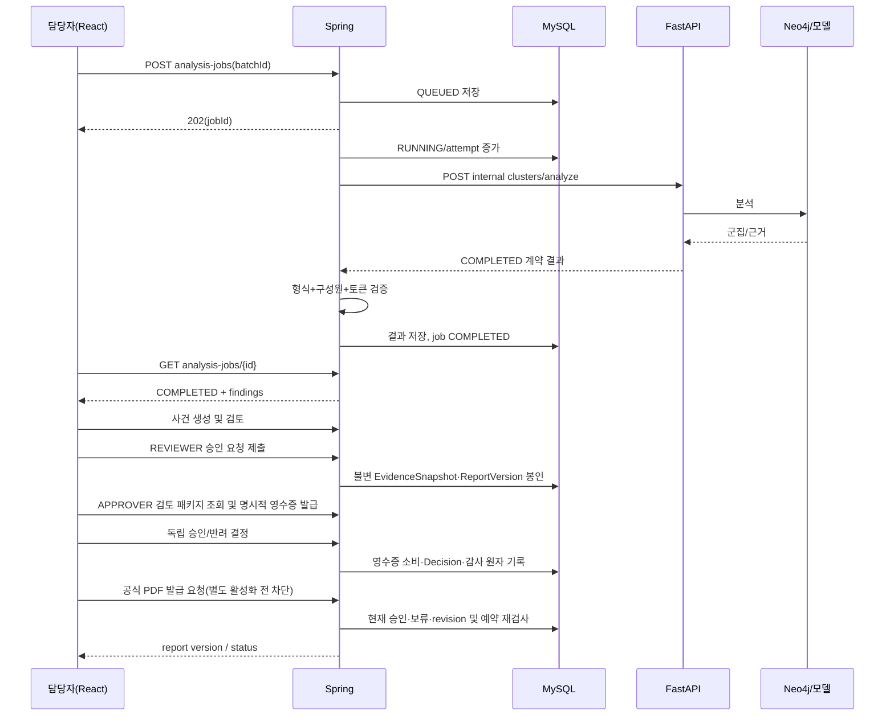

# 04. 사용자 시나리오·업무흐름·상태 전이

## 4계층 상태 모델 — 서로 합치지 말 것
1. `ImportBatch`: RECEIVED → VALIDATING → ACCEPTED 또는 REJECTED; ACCEPTED → ARCHIVED.
2. `AnalysisJob`: QUEUED → RUNNING → COMPLETED | RETRY_WAIT | FAILED | CANCELLED; RETRY_WAIT → QUEUED; FAILED → QUEUED(명시적 재실행, 새 attempt 기록). `COMPLETED`는 업무 승인 아님.
3. `Case`(기존 `FraudCase` 목표 객체): OPEN → TRIAGED → IN_REVIEW → NEEDS_EVIDENCE | READY_FOR_APPROVAL | DISMISSED; NEEDS_EVIDENCE → IN_REVIEW; READY_FOR_APPROVAL → IN_REVIEW | NEEDS_EVIDENCE 또는 **APPROVER Decision 결과로만** APPROVED_FOR_REPORT; APPROVED_FOR_REPORT → CLOSED 또는 관련 근거·보고서 내용 변경에 따른 IN_REVIEW; IN_REVIEW → CLOSED는 V2 증거 재검토 후 별도 사전 활동이 확인된 `NO_NEW_REPORT_AFTER_STALE`에 한정; DISMISSED → CLOSED. DISMISSED/CLOSED 직접 `REOPEN`은 MVP 제안에서 제외하고 새 근거는 연결된 후속 OPEN Case로 만든다. Specs DEC-12는 `PENDING`이다.
4. `ApprovalRequest`: PENDING → APPROVED | REJECTED | WITHDRAWN | INVALIDATED. 승인/반려는 별도 불변 `ApprovalDecision`으로 기록하며 결정당 하나의 Request와 서버 `ReviewReceipt`를 묶는다. `ReportVersion`: DRAFT → PENDING_APPROVAL → APPROVED | REJECTED | WITHDRAWN | INVALIDATED; APPROVED → RENDERING → GENERATED | GENERATION_FAILED 또는 공개 차단 시 APPROVED 복귀; GENERATION_FAILED → RENDERING(동일 봉인 입력·미종료 Case·현재 승인 재검사), GENERATED → SUPERSEDED(새 공식 PDF 공개 성공 시에만).

Track2 `ExtractionRun`: QUEUED → RUNNING → COMPLETED | FAILED; 각 **필드**의 상태는 `VISIBLE | ABSENT | UNREADABLE | AMBIGUOUS`, fieldValue는 뒤의 세 상태에서 기본적으로 null. 이미지 진위와 판매자 특정은 별도 판정 불가.

## 업무 시퀀스

## 상태별 프론트 액션 가드
| 대상/상태 | 표시 정보 | 가능한 버튼 | 금지 동작 |
|---|---|---|---|
| Import VALIDATING | 검증 진행률 | 새로고침 | 분석 시작 |
| Import ACCEPTED | 건수/오류 0 | 분석 실행 | 입력 행 임의 수정 |
| Job QUEUED | 대기열 위치 | 조회/취소(미시작인 경우) | 완료 결과 표시 |
| Job RUNNING | 시작시각/소요시간 | 조회 | 중복 재시도 |
| Job RETRY_WAIT | 오류 종류/재시도 시각 | 조회, 권한별 재시도 | 정상 0건 표시 |
| Job FAILED | 오류/요청ID | 재시도(권한·횟수) | 결과 승인 |
| Job COMPLETED | 분석 결과·버전 | 결과 보기/사건 연결 | 동일 작업 상태 재수정 |
| Case IN_REVIEW | 증거·검토 | 교정/추가자료/보류/승인요청 | PDF 최종 생성 |
| Case READY_FOR_APPROVAL | 현재 snapshot·봉인된 초안·PENDING 여부 | REVIEWER 요청 제출/철회, APPROVER 검토 패키지·결정, PENDING이 없으면 REVIEWER 검토 복귀 | Case 전이 API로 직접 APPROVED_FOR_REPORT 설정 또는 PENDING 우회 복귀 |
| Case APPROVED_FOR_REPORT | 승인 바인딩·발급 보류·현재 적격성 | 허용된 공식 발급 예약 또는 사유를 남긴 종료 | ACTIVE 보류·STALE 근거로 신규 발급 |
| Case CLOSED | closureDisposition·과거 보고서 | 권한별 기존 PDF 동일 파일 재다운로드 | 신규 렌더·실패 재시도·직접 REOPEN |
| Report GENERATED | 버전·SHA256 | 권한별 내려받기 | 파일 덮어쓰기 |

## 예외 흐름
- 이미지 미판독: Extraction COMPLETED일 수 있으나 field UNREADABLE; Case는 NEEDS_EVIDENCE 가능.
- 분석 실패: Job FAILED/RETRY_WAIT; 기존 Case와 무관하며 기존 증거를 지우지 않음.
- 두 트랙 동일 reservation: 하나의 Case에 `case_finding` 다대다 첨부; 자동 병합하지 않고 담당자 확인.
- 같은 이미지 반복: 파일 SHA 중복 힌트를 제공하되 새 신고를 단순 폐기하지 않음.
- 보고서 발행 뒤 새로운 증거: 기존 GENERATED·Decision은 불변. 현재 `approvalEligibility=STALE`로 만들고 새 EvidenceSnapshot·ReportVersion 내용 revision·승인 절차를 거친다. 신규 PDF가 공식 공개되기 전에는 이전 GENERATED를 SUPERSEDED로 바꾸지 않는다.
- 상태변경 동시성: Case `caseVersion`/명령 `expectedCaseVersion` 체크 후 409 충돌 안내. Evidence Revision과 ReportVersion 내용 revision/상태 잠금 version은 별개다.
- 중요·반대 정보 관련성 평가 전에도 `IssuanceHold.ACTIVE`를 서버에 지속 기록해 새 승인 결정·발급 예약·공개를 막는다. 관련성이 확인되면 근거 revision과 적격성을 갱신하고 해제하며, 무관성이 확인되면 근거·감사를 남기고 해제한다.

## Case 종료 분기와 사전 검토 활동 (Backend PR #21과 동기화한 PROPOSED MVP)

| 출발 상태 | closureDisposition | 필수 검증 및 기록 |
|---|---|---|
| APPROVED_FOR_REPORT | GENERATED_REPORT | 현재 승인 바인딩의 ReportVersion PDF가 공식 `GENERATED`, `closureReportVersionId` 일치. 종료 사유 기록. |
| APPROVED_FOR_REPORT | ISSUANCE_ABANDONED | 현재 버전 미발급·미예약, 별도 `issuanceAbandonmentReason`과 종료 사유, 포기·종료 감사 원자 기록. 발급 완료가 아님. |
| DISMISSED | NOT_APPLICABLE | 근거 있는 조사상 기각. STALE 또는 발급 포기만으로 기각 금지. |
| IN_REVIEW | NO_NEW_REPORT_AFTER_STALE | 증거 V2 반영으로 이전 승인 적격성이 STALE이고 현재 증거 revision이 승인 snapshot보다 큼. REVIEWER가 종료 **전에** 별도 `POST /api/v1/cases/{caseId}/evidence-review-completions`에서 현재 revision·snapshot ID/manifest digest·`NO_NEW_REPORT`·사유를 묶어 `EVIDENCE_REVIEW_COMPLETED` CaseActivity를 확정. 종료 명령은 그 `reviewActivityId`, `reviewedEvidenceRevision`, 공통 종료 사유, 별도 `noNewReportReason`을 요구. |

검토 완료 명령은 `expectedCaseVersion`과 멱등성 키를 요구하며, 저장된 REVIEWER actor·서버 시각·tenant/event/Case·현재 snapshot ID/hash/revision을 고정하고 Case 버전을 증가시킨다. GET·운영 메모·종료 명령은 이 활동을 만들지 않는다. 종료 서버는 당시 REVIEWER 권한과 `reviewOutcome`, V3 변경 여부, 과거 STALE Decision, ACTIVE 보류·PENDING 요청·렌더 예약 부재를 같은 직렬화 경계에서 다시 확인한다. ReportVersion 본문 변경만으로 STALE인 경우는 이 종료 분기가 아니다. 미존재·타 범위 활동 ID는 404, 잘못된 활동 유형 또는 바인딩 불일치는 409. 종료 활동·ApprovalAuditEvent·상태/버전은 원자 기록하고 과거 V1 PDF ID는 서버 이력에서 연결한다. V1 파일은 통제된 재다운로드만 가능하며 V2 신규 발급 근거가 아니다. 모든 CLOSED 분기에서 ACTIVE 보류와 렌더 예약을 거절한다.
