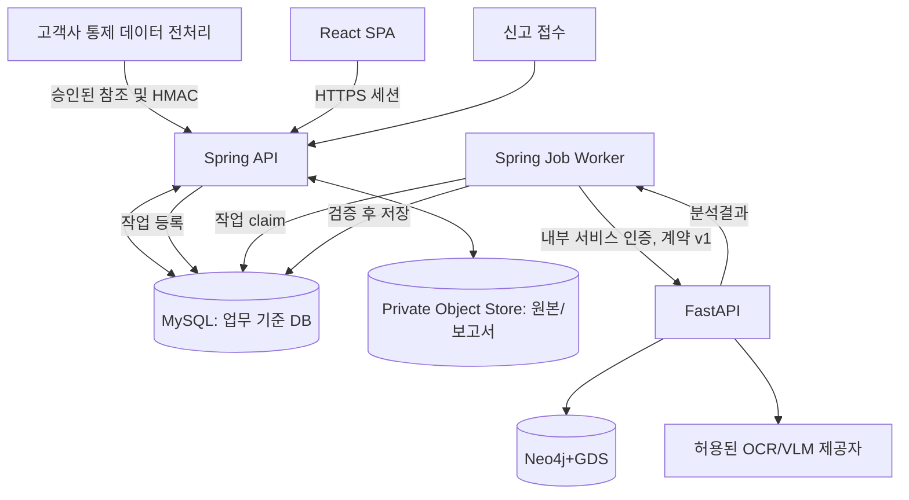

# 05. 시스템 아키텍처 / 분석 워커 설계

## 현행-목표 차이
**확인된 현행**: Spring Boot 4.1.1, MySQL 8.0, FastApiAdapter 3s/5s HTTP, FastAPI `/clusters/macro` + `/parse/ticket-image`, Neo4j 5.12, Gemini. 프론트엔드 저장소는 이번 검토 대상에 포함되지 않음. **목표**: Spring의 일관된 사건/작업 API와 React 프론트, worker, Neo4j·비공개 파일 보관.

## C4 논리 구조

## 기술 결정 ADR
- ADR-01: **MySQL 유지**. 코드와 Docker가 이미 사용. PostgreSQL 이전은 실제 기능 요구 충족 실패/정량 성능 문제 시 별도 ADR; 이전을 지금 진행하면 마이그레이션·테스트 비용만 증가.
- ADR-02: **외부 비동기 + 내부 동기 v1**. React 호출은 202 job ID 즉시 반환, Spring worker가 FastAPI sync 호출. 기존 Spring DTO/endpoint 재활용. 단, 실제 분석이 5초 넘어갈 수 있어 worker 전용 client timeout·작업량·실행수 제한 필요.
- ADR-03: **별도 Spring worker 프로세스**(동일 코드베이스라도 실행 프로파일 별도) 고려. API 노드의 worker thread와 DB 연결 풀을 고갈시키지 않기 위함.
- ADR-04: **MySQL 작업 큐부터 시작**. `SELECT ... FOR UPDATE SKIP LOCKED`로 job claim(트랜잭션 짧게); 실행 중 DB 락 장기 보유 금지. claim 후 lease_until과 heartbeat으로 복구.
- ADR-05: **대용량 처리 확장**. 내부 요청이 길어져 스레드/메모리 한계를 넘으면 Python 독립 큐 워커 + 202 internal task API v2로 전환. Kafka는 다수 이벤트 스트림/재생 요구를 충족할 때만.

## 비동기 job 프로토콜
`QUEUED` → claim(owner, leaseUntil, attemptNo) → `RUNNING` → `COMPLETED` 또는 `RETRY_WAIT`/`FAILED`.
- DB unique(tenant_id, idempotency_key)와 `request_hash`로 동일 재전송 식별.
- 422 계약 오류는 재시도 X; 429/503/network timeout은 지수 백오프+random jitter, 총 시도 상한.
- lease 만료 후 실패한 worker의 작업은 검토 후 재claim; 오래된 worker 응답은 `attemptId` fencing token으로 차단.
- FastAPI `requestId` 단위 재시도는 Neo4j 멱등성 보장; network timeout 후 실제 분석 완료 가능성을 고려.
- 장애 시 `UNAVAILABLE`로 사건 등록 금지, 빈 cluster 목록으로 안전하다고 표시 금지.
- UI polling 3~5초 초기값, 백오프; 추후 SSE 선택적 도입.

## 데이터 저장 책임
- MySQL: users/memberships, batches/jobs/runs, findings, cases, reviews, report metadata, audit.
- Neo4j: tenant-scoped account/reservation/event/token graph, algorithm projection은 일시적이며 재생성 가능.
- Object store: 원본 증거와 PDF binary; app DB에는 objectKey + checksum + 버전 + 권한만.
- 고객사 로컬: 원본 이름/연락처/결제 정보를 포함한 내부 매핑.

## 장애 도메인·복구
| 장애 | 사용자 상태 | 서버 조치 | 금지 |
|---|---|---|---|
| FastAPI 연결 실패 | 분석 재시도 중/실패 | retryable 분류, attempt 기록 | 0건 확정 |
| Neo4j GDS 메모리 부족 | FAILED_RESOURCE | 배치/프로젝션 축소, 회로차단 | 자동 대량 재실행 폭주 |
| VLM 429/timeout | RETRY_WAIT | retry-after 우선, 지수 백오프 | 원본 이미지 로깅 |
| PDF 렌더 실패 | GENERATION_FAILED | 동일 스냅샷으로 재시도 | 승인 상태 초기화 |
| MySQL 중단 | 읽기/쓰기 오류 | 재기동/백업 복구 및 alert | 파일만 보고 사건 완료 처리 |

## 배포 경계
Spring 외부 HTTPS(보안 프록시), FastAPI/Neo4j/MySQL/object storage private network, 기술계정 최소권한. 실서비스는 비밀번호/토큰 .env 커밋 금지, TLS/인증/모니터링 도입. Neo4j GDS plugin/version/메모리 가용량 확인 없는 시연 성공 가정 금지.
