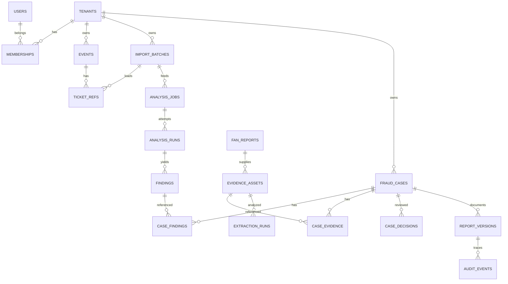

# 06. 실제 MySQL 전제 ERD 및 데이터 사전 + Neo4j 스키마

> **변경 필수 주의:** 이 문서는 현재 엔티티를 전수 확인한 결과가 아니라, `build.gradle`, compose, application.yml의 **MySQL 8.0**을 기준으로 한 목표 논리 스키마다. Codex는 실제 엔티티와 migration을 비교해 추가/변경만 하며 기존 테이블을 즉시 삭제·교체하지 않는다.

## ERD

## SQL 데이터 사전 (권장 MySQL 타입)
아래 `fraud_cases`·`case_decisions`·`report_versions` 행은 초기 목표 스케치다. Backend PR #21의 Case·Approval 제안에 필요한 영속 객체·버전 경계를 모두 표현하지 못하므로 이 행만으로 DDL을 확정하지 않는다. 기존 `version` 물리 컬럼의 API 투영이나 `case_decisions`의 전환/승인 분할은 실제 엔티티·migration 비교와 공유 승인 후 정한다.
기본 공통 칼럼: `id CHAR(36) CHARACTER SET ascii COLLATE ascii_bin PK`, `tenant_id CHAR(36)` (tenant 소유 엔티티), `created_at DATETIME(6) UTC`, `updated_at DATETIME(6) UTC`, `version BIGINT NOT NULL DEFAULT 0` (낙관적 락). 보존 기한·삭제상태 별도.

| Table | 주요 칼럼·타입 | FK / UNIQUE / CHECK | 소유자 |
|---|---|---|---|
| tenants | name VARCHAR(160), status VARCHAR(30) | unique business key | Spring |
| users | subject VARCHAR(191), status VARCHAR(24) | unique(subject) | Spring auth |
| memberships | user_id,tenant_id,role VARCHAR(30) | FK both, UNIQUE(tenant_id,user_id,role) | Spring |
| events | tenant_id,external_event_ref VARCHAR(128),name VARCHAR(255),starts_at DATETIME(6) | UNIQUE(tenant_id,external_event_ref) | Spring |
| import_batches | tenant_id,source_id VARCHAR(80),input_sha256 CHAR(64),status VARCHAR(24),row_count INT | unique(tenant_id,source_id,input_sha256) 정책별 | Spring |
| ticket_refs | tenant_id,event_id,account_ref VARCHAR(128),reservation_ref VARCHAR(128),batch_id | UNIQUE(tenant_id,event_id,account_ref,reservation_ref) | Spring |
| analysis_jobs | tenant_id,batch_id,type VARCHAR(24),status VARCHAR(24),idempotency_key VARCHAR(128),request_hash CHAR(64),lease_until DATETIME(6),attempt INT | UNIQUE(tenant_id,idempotency_key); CHECK(attempt>=0) | Spring |
| analysis_runs | job_id,attempt_no INT,status VARCHAR(24),algorithm VARCHAR(40),algorithm_version VARCHAR(80),started_at,completed_at,request_id CHAR(36),failure_code VARCHAR(60) | UNIQUE(job_id,attempt_no) | Spring |
| findings | tenant_id,run_id,cluster_key VARCHAR(160),risk_score DECIMAL(6,5),rationale_json JSON,members_json JSON,signals_json JSON | CHECK(risk_score between 0 and 1), unique(run_id,cluster_key) | Spring |
| fan_reports | tenant_id,event_id,source_ref VARCHAR(128),description TEXT,status VARCHAR(24) | report ID unique, dedupe 별도 | Spring |
| evidence_assets | tenant_id,fan_report_id,object_key VARCHAR(512),sha256 CHAR(64),media_type VARCHAR(80),byte_size BIGINT,retention_until DATETIME(6) | UNIQUE(tenant_id,object_key), sha 중복 허용 | Spring |
| extraction_runs | asset_id,model_name VARCHAR(100),model_version VARCHAR(100),status VARCHAR(24),fields_json JSON,observations_json JSON,revision INT | UNIQUE(asset_id,revision) | Spring |
| candidate_matches | tenant_id,extraction_id,event_id,ticket_ref_id nullable,status VARCHAR(30),match_features_json JSON | tenant FK/유효 범위 | Spring |
| fraud_cases | tenant_id,event_id,type VARCHAR(24),status VARCHAR(32),assignee_user_id nullable,summary TEXT,version BIGINT | FK tenant,event, assignee in tenant | Spring |
| case_findings | tenant_id,case_id,finding_id | UNIQUE(case_id,finding_id) | Spring |
| case_evidence | tenant_id,case_id,asset_id,extraction_id nullable | UNIQUE(case_id,asset_id,extraction_id) nullable 주의 | Spring |
| case_decisions | tenant_id,case_id,actor_id,from_state VARCHAR(32),to_state VARCHAR(32),reason TEXT,created_at | UPDATE/DELETE 제한; 초기 스케치의 상태 이력이며 신규 ApprovalDecision을 대신하지 않음 | Spring |
| report_versions | tenant_id,case_id,revision INT,status VARCHAR(32),snapshot_json JSON,object_key VARCHAR(512),sha256 CHAR(64),approved_by nullable,approved_at nullable | UNIQUE(case_id,revision); `approved_by`는 초기 스케치이며 단독 승인 기록으로 구현 금지 | Spring |
| audit_events | tenant_id,actor_id nullable,action VARCHAR(90),resource_type VARCHAR(50),resource_id CHAR(36),request_id CHAR(36),occurred_at,metadata_json JSON | append-only, 보존 정책 | Spring |

### Case·Approval 논리 관계 보완 제안 (DDL 미확정)

| 논리 객체 | 필요한 관계·불변식 |
|---|---|
| Case / CaseSourceReference / CaseActivity | Case는 tenant·event 소유와 독립 `caseId`를 가진다. `caseVersion`은 상태·배정·활동의 동시성 버전, `evidenceRevision`은 승인 근거 버전이다. 출처 연결은 제보 `fanReportId`, 그 제보 소속 파일 `evidenceId`, 분석 `(tenantId, analysisRunId, clusterId)`를 구분한다. 후속 Case는 종료 원 Case와 연결하되 승인·PDF를 승계하지 않는다. 활동은 append-only이며 `EVIDENCE_REVIEW_COMPLETED`의 `activityId`가 종료 명령의 `reviewActivityId`다. |
| EvidenceSnapshot / EvidenceItem | Case의 특정 `evidenceRevision`에 대한 불변 manifest ID·digest·항목 버전. 제보 파일 항목은 `evidenceId`와 소속 `fanReportId`를 함께 고정한다. 현재 snapshot 조회와 과거 snapshot 이력을 분리한다. |
| ReportVersion / ApprovalRequest / ApprovalDecision / ReviewReceipt | ReportVersion 내용 `revision`과 상태 lock `version`은 분리한다. 봉인된 내용 digest·템플릿과 snapshot ID/hash에 Request를 묶고 Request당 Decision은 최대 1건. 영수증의 서버 ID와 비밀 토큰 digest를 분리해 결정 시 1회 소비한다. 한 Case의 현재 발급 대상 PENDING 요청은 최대 1건이다. |
| IssuanceHold / ApprovalAuditEvent | 중요 정보 관련성 판단 전에도 `ACTIVE` 보류를 서버 저장한다. 해제는 사유·주체·시각·근거 revision·감사를 남긴다. 종료·승인·발급 게이트는 활성 보류를 같은 직렬화 경계에서 검사한다. 승인 감사는 업무 CaseActivity와 분리된 append-only 이력이며 둘을 ID로 연결한다. |

물리 테이블, FK/고유성 제약, nullable UNIQUE 처리, 기존 `TicketAudit`·`analysisRequestId`·이미지 URL의 이행표는 TD-07 및 관련 구현 작업에서 결정한다. `tenantId`는 인증된 서버 문맥에서 결정하고 모든 관계의 tenant/event·제보/증거 소속을 서버와 저장소 제약으로 확인한다. 이 논리 모델은 Backend PR #21 `c30f828`의 **PROPOSED·미구현** 설계이며 기존 데이터 마이그레이션이나 새 DB 컬럼의 승인 기록이 아니다.

## 테넌트 강제 전략
1. 모든 tenant 소유 테이블에 tenant_id + 조회 인덱스. FK 구조에서도 tenant 유효성 검사 (가능하면 composite FK `(tenant_id,id)`; 앱 layer 검사만으로 끝내지 않음).
2. MySQL에는 PostgreSQL RLS 같은 네이티브 정책이 동일하지 않으므로 Repository는 tenant scope 강제 + 권한 테스트.
3. `case_findings`와 `case_evidence` 교차테넌트 연결 차단을 FK+서비스 검증 양쪽에서 확인.
4. `tenant_id`는 authenticated membership으로 결정; 요청 본문 자체에 tenant_id가 있어도 단독 신뢰하지 않음.
5. 보존 기간·파기 신청·오브젝트·백업 정책 데이터 사전에 추가.

## Neo4j 목표 모델
- `(:Account {tenantId,accountId})`; UNIQUE composite.
- `(:Reservation {tenantId,reservationNo,eventId,accountId})`; 복합 unique 권장, 실제 고객사 식별키 확인.
- `(:Event {tenantId,eventId})`; `(:PaymentToken|AddressToken|DeviceToken|IpToken {tenantId,token,tokenVersion})`.
- `Account-[:MADE]->Reservation-[:FOR_EVENT]->Event`, `Reservation-[:USED_PAYMENT|USED_ADDRESS|USED_DEVICE|USED_IP {observedAt,sourceBatchId}]->Token`.
- 동일 계정의 다른 시점 예매를 잘못 결합하지 않도록 signal의 관측 시각·유효기간 유지.
- null token은 노드/관계 미생성, 빈 문자열/비정상 hex 입력 거부.
- 공유 IP 또는 고차수 허브를 무조건 부정확한 조직 증거로 보지 않음.
- 당장은 단일 테넌트 데모 전용. 진짜 multi-tenancy 전 Neo4j DB-per-tenant 또는 엄격한 필터/권한/프로젝션 격리 방식 검증.

## 마이그레이션 원칙
현재 실제 JPA 엔티티·스키마 미완전 열람. 기존 MySQL 데이터 백업, Flyway baseline 정책, 새 migration에는 additive DDL, 외래키·인덱스, `ddl-auto=validate`; prod `show-sql=false`. 기존 테이블을 이름만 보고 drop 하지 않음.
