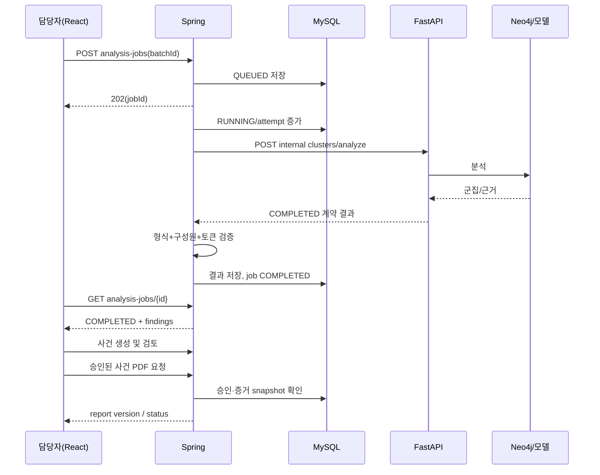
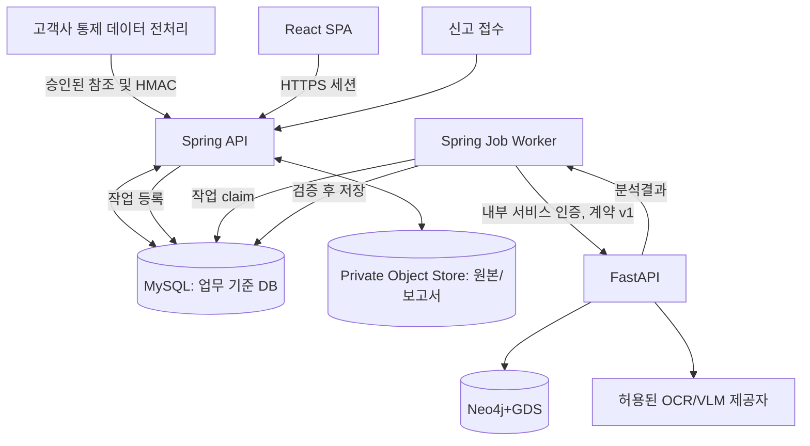
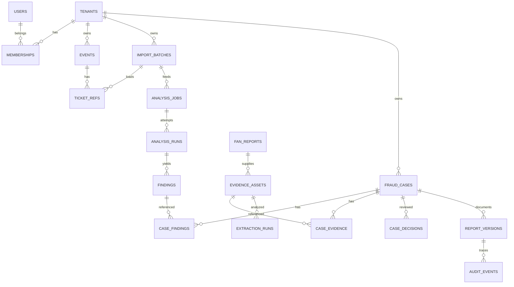

# Ticket Defender 종합 기준서 (문서 합본)

> 원본 파일별 수정·승인은 각각의 Markdown 파일을 기준으로 하며, 합본은 검색 편의용입니다.

---

# Ticket Defender 2026-10-11 아키텍처 감사와 결정 사항

> 문서 성격: 공개된 `main`의 **확인 가능한 소스 파일만** 근거로 작성한 부분 코드 감사 + 앞으로의 설계 제안. 저장소 전체 트리 열람 및 빌드 실행은 네트워크 제한으로 수행하지 못함. 따라서 '미구현'의 단정 대신 '열람한 범위에서 미확인'으로 표기한다.

## 점검한 실제 파일

| 저장소 | 실제 열람 파일 | 확인 내용 |
|---|---|---|
| backend | `build.gradle` | Spring Boot 4.1.1, Java 21, JPA, WebMVC, Validation, Resilience4j Spring Boot 3 starter, Thymeleaf, openhtmltopdf, MySQL |
| backend | `docker-compose.yml`, `.env.example`, `src/main/resources/application.yml` | MySQL 8.0, 로컬 3307, `ddl-auto: update`, `show-sql: true` |
| backend | `.../adapter/out/api/FastApiAdapter.java` | `/api/v1/clusters/analyze` 호출, 3초 connect/5초 read timeout, 계약 검증, `UNAVAILABLE` fallback |
| backend | `.../adapter/out/api/dto/MacroAnalysisRequest.java` | `requestId` + tickets(accountId,reservationNo,eventId, 4종 해시 토큰) |
| backend | `.../adapter/out/api/dto/MacroAnalysisResponse.java`, `FastApiClusterResponse.java` | COMPLETED/UNAVAILABLE, LOUVAIN 기대, clusters/members/riskScore |
| backend | `.../adapter/out/api/FastApiResponseContractException.java` | 비정상 분석 응답 구분 |
| data | `main.py`, `api/routes/graph_routes.py`, `schemas/dto.py` | `/api/v1/clusters/macro`; WCC + `{status,message,data}` |
| data | `services/graph_service.py` | Account/Payment/Address/Device/IP 적재, Reservation/Event 미보존, graph projection 전체 전역 |
| data | `api/routes/vlm_routes.py`, `services/vlm_service.py` | `/api/v1/parse/ticket-image`, Gemini JSON zone,row,seat; base64 입력 및 예외 처리 |
| data | `core/dependencies.py`, `.env.example`, `docker-compose.yml`, `requirements.txt` | singleton 의존성, Gemini API 키, Neo4j 5.12.0, GDS 구성 미확인 |

원문 링크: https://github.com/MINO-01/ticket-defender-backend / https://github.com/MINO-01/ticket-defender-data

## P0 결함 — 코드 증거와 수정 방안

**AUD-001 / API 불일치:** Spring `/clusters/analyze` vs Python `/clusters/macro` 및 상이한 입출력. [결정] Python에 v1 계약 구현, Spring의 기존 DTO·경로 보존. 기존 `/macro`는 내부 레거시로 폐기 또는 리다이렉트하지 않고 명시적으로 관리. [완료] 양 서버 계약 테스트/422/500/타임아웃 통과.

**AUD-002 / 알고리즘 불일치:** Spring 기대 알고리즘 `LOUVAIN`, Python 실제 `gds.wcc.stream`. [결정] WCC를 명시적 baseline으로 보존하고, v1 Louvain 구현을 독립 모듈화. Louvain=커뮤니티 탐지, 부정행위 확정 아님. [완료] 명시적 알고리즘 버전과 입력·출력 재현.

**AUD-003 / 엔티티 정보 손실:** Python은 reservationNo/eventId를 저장하지 않음. [결정] Reservation/Event를 그래프에 추가하거나 분석용 projection에서 예매 구분을 보존. [완료] `(accountId,reservationNo,eventId)` 식별자가 응답 구성원마다 존재하고 입력에 속함.

**AUD-004 / 격리 불능:** 현재 `MERGE (acc:Account {id:row.accountId})`; tenant 범위 없고 그래프 projection은 전체 노드 대상. [결정] tenant 인증 전까지 단일 신뢰 범위에서만 구동; 장기 다중 고객사 분석은 tenant별 네임스페이스/DB 및 권한·쿼리 격리 검증 이후 활성화. `tenantId`를 클라이언트 바디로 받는 것만으로 해결되지 않음.

**AUD-005 / 불완전한 토큰 입력:** Python 스키마는 토큰 4개를 필수 문자열로 받는 반면 Spring은 4개 nullable. null을 그대로 `MERGE` 하면 오류 가능. [결정] 최소 1개 신호만 요구하고 선택적 신호는 null 관계 생성 없이 적재.

**AUD-006 / 과도한 전역 그래프:** 요청마다 기존 그래프에 계속 적재하고 전체 DB에서 알고리즘 실행. [결정] 분석 실행 범위를 시간·고객사·배치/이벤트로 제한; 입력 스냅샷/재실행/청소 정책 정의.

**AUD-007 / GDS 검증:** `docker-compose.yml`의 기본 Neo4j 이미지 설정에 GDS 플러그인 설정이 확인되지 않음. [결정] GDS 라이선스·Neo4j/GDS 버전 호환, 절차 설치, `gds.version()` 헬스 체크.

**AUD-008 / 외부 VLM 전송:** 이미지가 외부 Gemini API로 전달되는 구현. [결정] 고객사별 데이터 처리 권한·재위탁·국외 이전·보존 검토 완료 전 실데이터 차단; 합성 이미지 테스트 우선.

**AUD-009 / VLM 실패/증거:** `json.loads(response.text)` 실패 때 이전 `response` 존재 가정 가능, 일반 예외가 전부 500, 로그에 응답 일부 출력 가능. [결정] 실패 유형 분류, 응답·원본 노출 금지, `UNREADABLE`과 `ABSENT` 구분, schema strict; 이미지 원본 저장과 추출 결과 분리.

**AUD-010 / Spring 배포 안전성:** 현재 MySQL·`ddl-auto:update`·SQL 로그. [결정] MySQL 유지, Flyway 선도입 및 `validate`; 운영 SQL 출력 금지. Spring Boot 4.1.1 + resilience4j-spring-boot3 조합 실제 호환 테스트 후 유지·교체 결정. openfeign 설정은 의존성 설치와 별개임.

**AUD-011 / fallback:** Spring `UNAVAILABLE(clusters=[])`는 단일 DTO 내에서 허용하지만 클라이언트가 빈 정상 분석으로 취급할 위험. [결정] 별도 analysis job 상태 FAILED/RETRY_WAIT에 매핑하고, 위험도가 0이라는 의미를 부여하지 않음. 계약 위반은 실패로 표면화.

**AUD-012 / 보안·인가:** 현재 열람 범위에서 인증·tenant isolation 적용 여부는 검증 불가. [결정] Spring 인증·인가, 파일 객체 권한, FastAPI 내부 전용 인증을 출시에 대한 hard gate로 설정.

## 중요 수정 순서 (이 순서 외의 대규모 기능 추가 중단)
1. P0-1 현행 DB/도메인 및 테스트 인벤토리 자동 수집; build/test baseline.
2. P0-2 Track 1 OpenAPI v1 고정; Spring-Python 계약 테스트.
3. P0-3 Neo4j Reservation/Event·token null·중복 방지 및 GDS 설치.
4. P0-4 Louvain 분리·리스크 근거 버전·오탐 방어.
5. P0-5 MySQL 데이터/작업/사건 상태 이력 설계 및 Flyway.
6. P0-6 단일 tenant demo와 멀티 tenant SaaS의 권한 경계 분리.
7. Track 2 증거 안전처리→사건 연동→PDF/프론트.

## 절대 혼동하면 안 되는 세 가지
- `AnalysisJob.status` = 기술적 실행 상태; `FraudCase.status` = 담당자의 업무 상태; `Report.status` = 보고서 승인·반출 상태.
- `COMPLETED`는 알고리즘 실행 완료이고 위법·부정행위 확정이 아니다.
- `MATCH_CANDIDATE`는 특정 좌석 후보가 조회된 사실이지 신고자가 그 예매를 판매했다는 뜻이 아니다.

## 검토 범위의 한계
GitHub 폴더 목록과 전체 commit SHA 확보, 실제 MySQL 마이그레이션 테이블 전수 확인, Java 클래스 전수 확인, Java/Python 테스트 수행, GDS 실제 실행은 완료하지 못했다. 따라서 06의 ERD와 07의 공용 API는 **제안안**이며 실제 프로젝트에 merge 하기 전에 현재 엔티티·마이그레이션·API와 diff가 필요하다.


---

# 01. 제품 요구사항 정의서 (PRD)

상태: **제안안 · MVP 기준** | 소유자: PM | 승인: 백엔드/분석/프론트/보안 담당

## 문제·사용자·가치
- 예매처 분석가: 다중 계정·결제·기기 연결을 근거로 조사 대상을 선별하고 싶다.
- 공연 기획사 담당자: 팬이 제출한 캡처에서 관찰 가능한 값을 추출하고, 권한이 있는 경우 예매 기록과 대조하고 싶다.
- 승인 담당자: 근거·출처·검토자를 남긴 PDF를 발행하고 싶다.
- 고객사 관리자는 자사 데이터와 직원 권한만 관리해야 한다.
- 플랫폼은 위법 사실을 자동 확정하거나 티켓을 취소하지 않는다.

## 가치와 차별점
1. Track 1: 가명 연결 신호로 관계 기반 조사 후보 선별.
2. Track 2: 제보 이미지 분석 및 예매 후보 대조.
3. 공통 Case: 근거·검토·반려·재분석·승인 통합.
4. PDF: 사실/모델 추출/담당자 판단을 구분하고 원본 해시·버전 기록.

## MVP Must (F-ID)
| ID | 요구사항 | 인수 기준 |
|---|---|---|
| F01 | 고객사·사용자·역할 | 다른 tenant 접근 차단 테스트 통과 |
| F02 | 예매 데이터 반입 | 스키마·해시 범위·중복 실패/성공 처리 |
| F03 | Track1 분석 작업 | 요청/실행/실패/결과 저장 분리 |
| F04 | 그래프 탐지 | 동일 입력 재현·계정/예매 정합성 |
| F05 | 팬 제보 이미지 접수 | 원본 보존·파일 검증·권한 |
| F06 | 이미지 추출·교정 | unreadable vs absent, 수동 정정 이력 |
| F07 | 권한 범위 내 예매 대조 | match/no_match/unverifiable 분리 |
| F08 | Case 통합·검토 | 소속·담당자·상태 전이 검증 |
| F09 | 근거 PDF | 승인 필요·스냅샷 고정·SHA-256 |
| F10 | 대시보드·감사 | 현재 상태, 실패·보류, 이력 조회 |

## Won't (MVP 제외)
실제 예약 취소/결제 환불 실행, 자동 처분, 정부 제보 API, 포상금/과징금 산정, 여러 독립 사업자의 교차 재식별, Kafka 고용량 실시간 처리, FastRP/PageRank 모델 결합, 72B 자체 GPU 서빙, 자동 학습 데이터 재주입, 무단 크롤링.

## 수용 기준과 KPI (실험 전 목표 / 수치 확정 전)
- 기능: Track1 끝단 계약 테스트, Track2 null/UNREADABLE 처리, 이중 권한 검사, 사건/보고서 상태 위반 차단.
- 성능: 반입량 1k/10k/100k 배치에서 시간·실패율·peak memory 실측. p95·p99 값은 측정 후 SLO 설정.
- 모델: Precision/Recall/PR-AUC·FPR(정상 신호 공유군), 이미지 필드별 exact match와 hallucination rate 비교.
- 업무: 사건당 검토시간·증거 누락률·보고서 준비시간 수작업 대비 A/B 비교.
- 데이터: 요청 유실 0(재시도·idempotency 테스트)와 접근 분리(타 tenant 행/파일/그래프 조회 0).
- 사업: 유료 고객 인터뷰/PoC 성공 기준(데이터 접근 계약 가능 여부, 현장 검토 시간 절감, 운영비)은 실증 후 확정.

## 출시 제한선
G0 소스 baseline 테스트→G1 API 계약 일치→G2 테넌트·권한 통과→G3 추론·파일 개인정보 평가→G4 업무 검토/보고 승인→G5 운영 복구; 통과 전 '실제 기업용 SaaS' 공개 불가.


---

# 02. 기능 명세서

기준: F01~F10 | 상태 코드는 04 참조 | 모든 ID는 고객사 소유권 검사 | 실제 endpoint는 07 참조

| ID | 입력값 | 처리 규칙 | 결과 | 실패·예외·프론트 표현 |
|---|---|---|---|---|
| F01 사용자 권한 | 인증 주체, tenant, 역할 | Spring 서버 검증, 요청 body tenant 신뢰하지 않음 | 허용 자원 | 401 미로그인, 403 역할 부족, 404 타 tenant 객체 은닉 |
| F02 데이터 반입 | event, account/reservation ref, HMAC 토큰 1개+ | 형식/스코프/중복/크기 검증, atomic batch 기록 | batchId, ACCEPTED/REJECTED | 행별 오류 목록; 실패 batch는 실행 금지 |
| F03 분석 생성 | batchId, algorithmVersion | idempotency 및 상태 예약, 권한 확인 | jobId, QUEUED | 중복은 같은 job 반환; 409 상태 충돌 |
| F04 그래프 분석 | 고정된 입력 스냅샷 | tenant 제한 그래프, Louvain, 근거 산출 | clusterIds, risk 0~1 | timeout→RETRY_WAIT 또는 FAILED; empty cluster는 실제 COMPLETED 때만 |
| F05 제보 | eventId, description, image | MIME/magic bytes/픽셀/악성파일/권한, SHA256, 안전 저장 | reportId, evidenceId | 413 크기 초과, 415 형식, 422 손상, 보관 실패 503 |
| F06 파싱 | evidenceId | 외부 VLM 사용권한 확인, 추출 nullable+상태, 교정 원본 보존 | extractionId, fields | UNREADABLE/ABSENT/UNKNOWN; 엔진 오류는 parse FAILED |
| F07 대조 | extractionId, 허용 DB 범위 | 공연+일시+구역+열+좌석 후보 조회, 과도한 후보 제한 | MATCH_CANDIDATE/NO_MATCH/UNVERIFIABLE | 미권한은 403, 근거 없음은 UNVERIFIABLE |
| F08 Case | findingIds, reportIds, 결합 사유 | tenant/event/reservation 동일성 검증, 증거 다대다 연결 | caseId, status | 병합은 자동이 아니라 검토; 충돌 409, 교차 tenant 404 |
| F09 PDF | caseId, approval version | 승인된 immutable snapshot; 누락 점검; hash+버전 기록 | reportVersionId, download | 비승인 409, 권한 403, 파일 생성 실패 FAILED |
| F10 모니터 | filters, date range | Spring 서버측 filter+pagination, audit | 집계·작업목록 | timeout은 지표 오류로 분리, 정상 0과 구별 |

## 업무 규칙의 경계
- 분석 성공 `COMPLETED`: 0개 클러스터도 정상 결과 가능. 분석 `FAILED`: 0개와 동의어가 아니다.
- 신고 파싱은 '원본 캡처에 인쇄된 문자열'만 관찰 결과로 보존; 판매자·위법성은 추론하지 않는다.
- 증거 수정 대신 새 extraction revision 생성; manual correction은 actor/time/reason 필요.
- Case에는 동일 예매의 Track1 finding과 Track2 evidence를 복수 연결 가능; 중복 Case 자동 병합 금지.
- PDF에 표시되는 금액은 관찰된 가격과 고객사 확인 가격을 별도 필드로 취급.

## 대표 인수 사례
- 동일 `Idempotency-Key`로 F03 2회 호출→job 1개; 다른 요청 body로 같은 키 재사용→409.
- Track1 결과 구성원에 입력에 없는 reservationNo→계약 오류, 사건 생성 없음.
- 이미지 좌석번호 마스킹→`UNREADABLE`, 좌석번호 자동 보완 금지.
- 직전 담당자가 사건을 CLOSED로 변경→이전 버전에서 APPROVE 시 409(낙관적 락).
- 다른 tenant 사용자가 보고서 ID 추측→404, 객체 스토리지 URL 발급 없음.


---

# 03. 사용자 역할·권한 정의서 (RBAC + tenant scope)

현재 소스 전체에서 인증 구현 여부가 확인된 것은 아니다. 아래는 도입 대상 **규범적 설계**다.

## 역할
- PLATFORM_OPERATOR: 서비스 상태·인프라 관리만; 고객 증거 원문 조회 불가(긴급 break-glass 승인 및 감사에 한정).
- TENANT_ADMIN: 자사 멤버십·정책·데이터 소스 구성.
- ANALYST: 자사 반입/분석/군집 조회 및 사건 초안 작성.
- REVIEWER: 자사 신고/증거 검토, 교정, 사건 상태 변경.
- APPROVER: 검토 완료 사건의 PDF 발행 승인(자기 승인 제한은 정책 확정).
- AUDITOR: 자사 감사 이벤트·보고서 기록 읽기 전용.
- REPORTER: 본인 신고 제출/제한된 접수 상태만; 내부 분석 원문 조회 불가.

## 권한 매트릭스
| 동작 | Admin | Analyst | Reviewer | Approver | Auditor | Reporter |
|---|---|---|---|---|---|---|
| 멤버십/역할 관리 | O | - | - | - | - | - |
| 반입 생성 | O | O | - | - | - | - |
| 분석 실행/재시도 | O | O | - | - | - | - |
| 그래프 후보 조회 | O | O | O | O | 읽기 | - |
| 신고 접수 | O | - | O | - | - | 본인 |
| 증거/추출 수정 | 정책 | - | 교정 신규버전 | - | 읽기 | - |
| 사건 배정 | O | - | O | - | - | - |
| 사건 검토 상태 | O | - | O | - | - | - |
| 보고서 초안 생성 | O | - | O | O | - | - |
| 보고서 승인/반려 | - | - | - | O | - | - |
| PDF 다운로드 | O | 권한범위 | O | O | O | - |
| 감사 기록 조회 | O | - | - | O(제한) | O | - |

**권한은 역할만으로 판단하지 않는다.** 필수 조건 `authenticated && member(tenant) && role.allow(action) && resource.tenantId==activeTenant && state.guard && objectScope`. 이벤트/공연 단위 제한도 필요하면 추가.

## 프론트와 API 적용
- 화면 버튼 숨김/비활성화는 UX일 뿐 보안이 아니다. Spring 메서드 + 서비스 객체 단위에서 재검증.
- 활성 tenant는 인증된 memberships에서만 선택; header tenant-id의 원문을 신뢰하지 않음.
- 403: 동일 tenant이나 부족한 역할, 404: 자원 존재를 노출하면 안 되는 다른 tenant 자원.
- 최소 업무 감사 필드: actor, tenant, resource, action, before/after state, reason, ip (필요한 범위), occurred_at, request_id.
- 내부 Spring→FastAPI는 일반 사용자 권한 토큰을 그대로 전달하지 않고 서비스 인증 + 서버가 결정한 tenant context를 사용.

## 권한 테스트
IDOR 다른 tenant case/evidence/report; BFLA Reviewer가 승인 endpoint 호출; REPORTER 대시보드 조회; 객체 저장소 key 추측; 분석 API 직접 호출; 종료된 사건 수정; 로그인 세션 회수. 모두 차단되어야 한다.


---

# 04. 사용자 시나리오·업무흐름·상태 전이

## 4계층 상태 모델 — 서로 합치지 말 것
1. `ImportBatch`: RECEIVED → VALIDATING → ACCEPTED 또는 REJECTED; ACCEPTED → ARCHIVED.
2. `AnalysisJob`: QUEUED → RUNNING → COMPLETED | RETRY_WAIT | FAILED | CANCELLED; RETRY_WAIT → QUEUED; FAILED → QUEUED(명시적 재실행, 새 attempt 기록). `COMPLETED`는 업무 승인 아님.
3. `FraudCase`: OPEN → TRIAGED → IN_REVIEW → NEEDS_EVIDENCE | READY_FOR_APPROVAL | DISMISSED; NEEDS_EVIDENCE → IN_REVIEW; READY_FOR_APPROVAL → APPROVED_FOR_REPORT | IN_REVIEW; APPROVED_FOR_REPORT → CLOSED; DISMISSED → CLOSED. CLOSED 이후에는 `REOPEN`을 감사 사유 포함한 명시적 새 이벤트로만 허용.
4. `ReportVersion`: DRAFT → PENDING_APPROVAL → APPROVED | REJECTED; APPROVED → RENDERING → GENERATED | GENERATION_FAILED; GENERATION_FAILED → RENDERING(버전/재시도 관리), GENERATED → SUPERSEDED(신규 버전 승인 시).

Track2 `ExtractionRun`: QUEUED → RUNNING → COMPLETED | FAILED; 각 **필드**의 상태는 `VISIBLE | ABSENT | UNREADABLE | AMBIGUOUS`, fieldValue는 뒤의 세 상태에서 기본적으로 null. 이미지 진위와 판매자 특정은 별도 판정 불가.

## 업무 시퀀스


## 상태별 프론트 액션 가드
| 대상/상태 | 표시 정보 | 가능한 버튼 | 금지 동작 |
|---|---|---|---|
| Import VALIDATING | 검증 진행률 | 새로고침 | 분석 시작 |
| Import ACCEPTED | 건수/오류 0 | 분석 실행 | 입력 행 임의 수정 |
| Job QUEUED | 대기열 위치 | 조회/취소(미시작인 경우) | 완료 결과 표시 |
| Job RUNNING | 시작시각/소요시간 | 조회 | 중복 재시도 |
| Job RETRY_WAIT | 오류 종류/재시도 시각 | 조회, 권한별 재시도 | 정상 0건 표시 |
| Job FAILED | 오류/요청ID | 재시도(권한·횟수) | 결과 승인 |
| Job COMPLETED | 분석 결과·버전 | 결과 보기/사건 연결 | 동일 작업 상태 재수정 |
| Case IN_REVIEW | 증거·검토 | 교정/추가자료/보류/승인요청 | PDF 최종 생성 |
| Case READY_FOR_APPROVAL | 검토 종료·필수항목 | 승인/반려(Approver) | 무근거 수정 |
| Report GENERATED | 버전·SHA256 | 권한별 내려받기 | 파일 덮어쓰기 |

## 예외 흐름
- 이미지 미판독: Extraction COMPLETED일 수 있으나 field UNREADABLE; Case는 NEEDS_EVIDENCE 가능.
- 분석 실패: Job FAILED/RETRY_WAIT; 기존 Case와 무관하며 기존 증거를 지우지 않음.
- 두 트랙 동일 reservation: 하나의 Case에 `case_finding` 다대다 첨부; 자동 병합하지 않고 담당자 확인.
- 같은 이미지 반복: 파일 SHA 중복 힌트를 제공하되 새 신고를 단순 폐기하지 않음.
- 보고서 발행 뒤 새로운 증거: 기존 GENERATED 불변; 신규 version 생성·승인.
- 상태변경 동시성: `version`/If-Match 체크 후 409 충돌 안내.


---

# 05. 시스템 아키텍처 / 분석 워커 설계

## 현행-목표 차이
**확인된 현행**: Spring Boot 4.1.1, MySQL 8.0, FastApiAdapter 3s/5s HTTP, FastAPI `/clusters/macro` + `/parse/ticket-image`, Neo4j 5.12, Gemini. 프론트엔드 저장소는 이번 검토 대상에 포함되지 않음. **목표**: Spring의 일관된 사건/작업 API와 React 프론트, worker, Neo4j·비공개 파일 보관.

## C4 논리 구조


## 기술 결정 ADR
- ADR-01: **MySQL 유지**. 코드와 Docker가 이미 사용. PostgreSQL 이전은 실제 기능 요구 충족 실패/정량 성능 문제 시 별도 ADR; 이전을 지금 진행하면 마이그레이션·테스트 비용만 증가.
- ADR-02: **외부 비동기 + 내부 동기 v1**. React 호출은 202 job ID 즉시 반환, Spring worker가 FastAPI sync 호출. 기존 Spring DTO/endpoint 재활용. 단, 실제 분석이 5초 넘어갈 수 있어 worker 전용 client timeout·작업량·실행수 제한 필요.
- ADR-03: **별도 Spring worker 프로세스**(동일 코드베이스라도 실행 프로파일 별도) 고려. API 노드의 worker thread와 DB 연결 풀을 고갈시키지 않기 위함.
- ADR-04: **MySQL 작업 큐부터 시작**. `SELECT ... FOR UPDATE SKIP LOCKED`로 job claim(트랜잭션 짧게); 실행 중 DB 락 장기 보유 금지. claim 후 lease_until과 heartbeat으로 복구.
- ADR-05: **대용량 처리 확장**. 내부 요청이 길어져 스레드/메모리 한계를 넘으면 Python 독립 큐 워커 + 202 internal task API v2로 전환. Kafka는 다수 이벤트 스트림/재생 요구를 충족할 때만.

## 비동기 job 프로토콜
`QUEUED` → claim(owner, leaseUntil, attemptNo) → `RUNNING` → `COMPLETED` 또는 `RETRY_WAIT`/`FAILED`.
- DB unique(tenant_id, idempotency_key)와 `request_hash`로 동일 재전송 식별.
- 422 계약 오류는 재시도 X; 429/503/network timeout은 지수 백오프+random jitter, 총 시도 상한.
- lease 만료 후 실패한 worker의 작업은 검토 후 재claim; 오래된 worker 응답은 `attemptId` fencing token으로 차단.
- FastAPI `requestId` 단위 재시도는 Neo4j 멱등성 보장; network timeout 후 실제 분석 완료 가능성을 고려.
- 장애 시 `UNAVAILABLE`로 사건 등록 금지, 빈 cluster 목록으로 안전하다고 표시 금지.
- UI polling 3~5초 초기값, 백오프; 추후 SSE 선택적 도입.

## 데이터 저장 책임
- MySQL: users/memberships, batches/jobs/runs, findings, cases, reviews, report metadata, audit.
- Neo4j: tenant-scoped account/reservation/event/token graph, algorithm projection은 일시적이며 재생성 가능.
- Object store: 원본 증거와 PDF binary; app DB에는 objectKey + checksum + 버전 + 권한만.
- 고객사 로컬: 원본 이름/연락처/결제 정보를 포함한 내부 매핑.

## 장애 도메인·복구
| 장애 | 사용자 상태 | 서버 조치 | 금지 |
|---|---|---|---|
| FastAPI 연결 실패 | 분석 재시도 중/실패 | retryable 분류, attempt 기록 | 0건 확정 |
| Neo4j GDS 메모리 부족 | FAILED_RESOURCE | 배치/프로젝션 축소, 회로차단 | 자동 대량 재실행 폭주 |
| VLM 429/timeout | RETRY_WAIT | retry-after 우선, 지수 백오프 | 원본 이미지 로깅 |
| PDF 렌더 실패 | GENERATION_FAILED | 동일 스냅샷으로 재시도 | 승인 상태 초기화 |
| MySQL 중단 | 읽기/쓰기 오류 | 재기동/백업 복구 및 alert | 파일만 보고 사건 완료 처리 |

## 배포 경계
Spring 외부 HTTPS(보안 프록시), FastAPI/Neo4j/MySQL/object storage private network, 기술계정 최소권한. 실서비스는 비밀번호/토큰 .env 커밋 금지, TLS/인증/모니터링 도입. Neo4j GDS plugin/version/메모리 가용량 확인 없는 시연 성공 가정 금지.


---

# 06. 실제 MySQL 전제 ERD 및 데이터 사전 + Neo4j 스키마

> **변경 필수 주의:** 이 문서는 현재 엔티티를 전수 확인한 결과가 아니라, `build.gradle`, compose, application.yml의 **MySQL 8.0**을 기준으로 한 목표 논리 스키마다. Codex는 실제 엔티티와 migration을 비교해 추가/변경만 하며 기존 테이블을 즉시 삭제·교체하지 않는다.

## ERD


## SQL 데이터 사전 (권장 MySQL 타입)
기본 공통 칼럼: `id CHAR(36) CHARACTER SET ascii COLLATE ascii_bin PK`, `tenant_id CHAR(36)` (tenant 소유 엔티티), `created_at DATETIME(6) UTC`, `updated_at DATETIME(6) UTC`, `version BIGINT NOT NULL DEFAULT 0` (낙관적 락). 보존 기한·삭제상태 별도.

| Table | 주요 칼럼·타입 | FK / UNIQUE / CHECK | 소유자 |
|---|---|---|---|
| tenants | name VARCHAR(160), status VARCHAR(30) | unique business key | Spring |
| users | subject VARCHAR(191), status VARCHAR(24) | unique(subject) | Spring auth |
| memberships | user_id,tenant_id,role VARCHAR(30) | FK both, UNIQUE(tenant_id,user_id,role) | Spring |
| events | tenant_id,external_event_ref VARCHAR(128),name VARCHAR(255),starts_at DATETIME(6) | UNIQUE(tenant_id,external_event_ref) | Spring |
| import_batches | tenant_id,source_id VARCHAR(80),input_sha256 CHAR(64),status VARCHAR(24),row_count INT | unique(tenant_id,source_id,input_sha256) 정책별 | Spring |
| ticket_refs | tenant_id,event_id,account_ref VARCHAR(128),reservation_ref VARCHAR(128),batch_id | UNIQUE(tenant_id,event_id,account_ref,reservation_ref) | Spring |
| analysis_jobs | tenant_id,batch_id,type VARCHAR(24),status VARCHAR(24),idempotency_key VARCHAR(128),request_hash CHAR(64),lease_until DATETIME(6),attempt INT | UNIQUE(tenant_id,idempotency_key); CHECK(attempt>=0) | Spring |
| analysis_runs | job_id,attempt_no INT,status VARCHAR(24),algorithm VARCHAR(40),algorithm_version VARCHAR(80),started_at,completed_at,request_id CHAR(36),failure_code VARCHAR(60) | UNIQUE(job_id,attempt_no) | Spring |
| findings | tenant_id,run_id,cluster_key VARCHAR(160),risk_score DECIMAL(6,5),rationale_json JSON,members_json JSON,signals_json JSON | CHECK(risk_score between 0 and 1), unique(run_id,cluster_key) | Spring |
| fan_reports | tenant_id,event_id,source_ref VARCHAR(128),description TEXT,status VARCHAR(24) | report ID unique, dedupe 별도 | Spring |
| evidence_assets | tenant_id,fan_report_id,object_key VARCHAR(512),sha256 CHAR(64),media_type VARCHAR(80),byte_size BIGINT,retention_until DATETIME(6) | UNIQUE(tenant_id,object_key), sha 중복 허용 | Spring |
| extraction_runs | asset_id,model_name VARCHAR(100),model_version VARCHAR(100),status VARCHAR(24),fields_json JSON,observations_json JSON,revision INT | UNIQUE(asset_id,revision) | Spring |
| candidate_matches | tenant_id,extraction_id,event_id,ticket_ref_id nullable,status VARCHAR(30),match_features_json JSON | tenant FK/유효 범위 | Spring |
| fraud_cases | tenant_id,event_id,type VARCHAR(24),status VARCHAR(32),assignee_user_id nullable,summary TEXT,version BIGINT | FK tenant,event, assignee in tenant | Spring |
| case_findings | tenant_id,case_id,finding_id | UNIQUE(case_id,finding_id) | Spring |
| case_evidence | tenant_id,case_id,asset_id,extraction_id nullable | UNIQUE(case_id,asset_id,extraction_id) nullable 주의 | Spring |
| case_decisions | tenant_id,case_id,actor_id,from_state VARCHAR(32),to_state VARCHAR(32),reason TEXT,created_at | UPDATE/DELETE 제한 | Spring |
| report_versions | tenant_id,case_id,revision INT,status VARCHAR(32),snapshot_json JSON,object_key VARCHAR(512),sha256 CHAR(64),approved_by nullable,approved_at nullable | UNIQUE(case_id,revision) | Spring |
| audit_events | tenant_id,actor_id nullable,action VARCHAR(90),resource_type VARCHAR(50),resource_id CHAR(36),request_id CHAR(36),occurred_at,metadata_json JSON | append-only, 보존 정책 | Spring |

## 테넌트 강제 전략
1. 모든 tenant 소유 테이블에 tenant_id + 조회 인덱스. FK 구조에서도 tenant 유효성 검사 (가능하면 composite FK `(tenant_id,id)`; 앱 layer 검사만으로 끝내지 않음).
2. MySQL에는 PostgreSQL RLS 같은 네이티브 정책이 동일하지 않으므로 Repository는 tenant scope 강제 + 권한 테스트.
3. `case_findings`와 `case_evidence` 교차테넌트 연결 차단을 FK+서비스 검증 양쪽에서 확인.
4. `tenant_id`는 authenticated membership으로 결정; 요청 본문 자체에 tenant_id가 있어도 단독 신뢰하지 않음.
5. 보존 기간·파기 신청·오브젝트·백업 정책 데이터 사전에 추가.

## Neo4j 목표 모델
- `(:Account {tenantId,accountId})`; UNIQUE composite.
- `(:Reservation {tenantId,reservationNo,eventId,accountId})`; 복합 unique 권장, 실제 고객사 식별키 확인.
- `(:Event {tenantId,eventId})`; `(:PaymentToken|AddressToken|DeviceToken|IpToken {tenantId,token,tokenVersion})`.
- `Account-[:MADE]->Reservation-[:FOR_EVENT]->Event`, `Reservation-[:USED_PAYMENT|USED_ADDRESS|USED_DEVICE|USED_IP {observedAt,sourceBatchId}]->Token`.
- 동일 계정의 다른 시점 예매를 잘못 결합하지 않도록 signal의 관측 시각·유효기간 유지.
- null token은 노드/관계 미생성, 빈 문자열/비정상 hex 입력 거부.
- 공유 IP 또는 고차수 허브를 무조건 부정확한 조직 증거로 보지 않음.
- 당장은 단일 테넌트 데모 전용. 진짜 multi-tenancy 전 Neo4j DB-per-tenant 또는 엄격한 필터/권한/프로젝션 격리 방식 검증.

## 마이그레이션 원칙
현재 실제 JPA 엔티티·스키마 미완전 열람. 기존 MySQL 데이터 백업, Flyway baseline 정책, 새 migration에는 additive DDL, 외래키·인덱스, `ddl-auto=validate`; prod `show-sql=false`. 기존 테이블을 이름만 보고 drop 하지 않음.


---

# 07. REST API/DTO/오류 규약 — v1 제안

> 기존 **실제 내부 Spring** `POST /api/v1/clusters/analyze`와 응답 DTO 유지가 최우선. Python 실제 `/api/v1/clusters/macro`는 미정렬 구현이므로 아래 INTERNAL target은 아직 작동한다고 주장하지 않는다. 상세 예시는 `contracts/openapi-proposal.yaml` 참조.

## 관리자 API — Spring (모두 인증 필요)
| Method | Path | Request | 2xx | 역할 | 주의 |
|---|---|---|---|---|---|
| POST | /api/v1/import-batches | eventId, sourceId, tickets[], idempotency | 202 batchId/status | Admin/Analyst | 422 형식, 409 중복키 충돌 |
| GET | /api/v1/import-batches/{id} | - | 200 batch/status/errors | Admin/Analyst | tenant scope |
| POST | /api/v1/analysis-jobs | batchId, algorithm=LOUVAIN | 202 jobId,QUEUED | Admin/Analyst | 409 상태충돌 |
| GET | /api/v1/analysis-jobs/{id} | - | 200 status/attempt/errors | team read | 실패 ≠ 완료 0건 |
| POST | /api/v1/analysis-jobs/{id}/retry | reason | 202 jobId/status | Admin/Analyst | FAILED/RETRY_WAIT만 |
| GET | /api/v1/findings | eventId, pagination | 200 page/items | analysts+ | risk는 확률 아님 |
| GET | /api/v1/findings/{id} | - | 200 members/signals | analysts+ | evidence source |
| POST | /api/v1/fan-reports | multipart image/eventId/description | 201 reportId,evidenceId | Reporter/Reviewer | 413/415/422 |
| GET | /api/v1/fan-reports/{id} | - | 200 report/extraction | Reviewer/본인 제한 | raw image URL 비공개 |
| POST | /api/v1/fan-reports/{id}/extractions | mode | 202 extractionRunId | Reviewer | provider permission |
| POST | /api/v1/extractions/{id}/corrections | fields + reason, If-Match | 201 revision | Reviewer | 원본 overwrite 금지 |
| POST | /api/v1/cases | eventId,type,findingIds,evidenceIds | 201 caseId,OPEN | Analyst/Reviewer | 자동 병합 금지 |
| GET | /api/v1/cases | query/page | 200 items | member authorized | tenant scope |
| GET | /api/v1/cases/{id} | - | 200 status/evidence/permissions | member authorized | 허용 actions 제공 |
| POST | /api/v1/cases/{id}/transitions | toStatus,reason,expectedVersion | 200 status/version | Reviewer/Approver | 상태가드+409 |
| POST | /api/v1/cases/{id}/report-versions | evidence snapshot | 201 reportVersionId | Reviewer | 승인 전 DRAFT |
| POST | /api/v1/report-versions/{id}/approve | decision,reason,expectedVersion | 200 APPROVED | Approver | 자기승인 정책 결정 |
| POST | /api/v1/report-versions/{id}/render | - | 202 RENDERING | Approver | 승인 필요 |
| GET | /api/v1/report-versions/{id}/download | - | 200 signed URL/stream | allowed | audit 생성 |

## 내부 분석 API — Python v1 계약 (target)
`POST /api/v1/clusters/analyze` : `{requestId: UUID, tickets: [{accountId,reservationNo,eventId,paymentHash?,addressHash?,deviceIdHash?,ipHash?}]}`. 최소 1 티켓, 각 티켓 최소 1 토큰, 64자리 lowercase HMAC hex. tenant context는 외부 사용자 입력이 아닌 인증된 내부 서비스 신뢰 범위. 최초 v1에서는 **한 요청에 단일 tenant만**, 그래프 DB도 단일 tenant 격리 조건 검증 전엔 demo-only.

응답(성공): `{requestId,status:"COMPLETED",algorithm:"LOUVAIN",algorithmVersion,analyzedAt,clusters:[{clusterId,members:[{accountId,reservationNo,eventId}],paymentHashes,addressHashes,deviceIdHashes,ipHashes,riskScore}]}`. 모든 배열 non-null, 구성원 >=2, 점수 `[0,1]`, 입력에 없는 예매 반환 금지.

**주의:** 응답의 각 토큰은 해당 cluster 구성원의 입력에 존재하는 토큰임을 서버에서 추가 검증하는 방안을 권장한다. 기존 Spring은 형식과 멤버십은 검증하지만 토큰의 소속 여부까지 모두 확인하는지는 추가 테스트 필요.

## 내부 Track2 API (신규 target)
`POST /api/v1/parse/ticket-image`: 현행 base64 API를 임시 보존하되 내부 서비스 인증/이미지 검증, 결과 `fieldObservations`(zone/row/seat 각각 state/value/source) 및 model/version으로 v2 설계; 요청 업로드 파일이 반드시 Spring의 검증을 거치도록 한다. 5MB 문자열 제한과 실제 디코딩 바이트 제한 별도로 검증.

## 상태 코드 / 오류
| Code | 의미 | 클라이언트 대응 |
|---|---|---|
| 400 | 잘못된 입력 구조 | 수정 유도 |
| 401 | 인증 없음 | 로그인 유도 |
| 403 | 기능 권한 없음 | 액션 차단 |
| 404 | 객체 없음/타 tenant | 식별자 존재 노출 금지 |
| 409 | 상태/버전/idempotency 충돌 | 최신 상태 새로고침 |
| 413 | 크기 제한 초과 | 파일 크기 안내 |
| 415 | 지원하지 않는 MIME | 형식 안내 |
| 422 | 필드 제약 위반 | `violations` 표시 |
| 429 | 요청 제한 | retry-after 존중 |
| 502 | 하위 분석 응답 계약 위반 | 오류 기록/운영 알림 |
| 503 | 분석 서비스 일시적 사용 불가 | job 재시도 정책 |
| 504 | 내부 분석 타임아웃 | job FAILED/RETRY_WAIT |

오류 공통 `{type,title,status,code,detail,requestId,violations?}` (`application/problem+json`). 민감 정보, 원본 토큰, 원본 이미지, stacktrace 응답 금지.

## API 설계 일관성 규칙
모든 list는 cursor/pageSize 상한, createdAt UTC ISO8601, key는 camelCase, 단순 ID로 tenant 보안 미보장, `Idempotency-Key`와 expectedVersion/If-Match, webhook은 MVP 제외, 수정은 승인 및 증거 snapshot audit 기록. OpenAPI 계약 테스트는 Java DTO serialization, Pydantic model, backend frontend generated TS types에 동일 샘플 사용.


---

# 08. 데이터 수집/전처리/동일성 명세

## 수집 원칙
- 예매처가 적법하게 처리 가능한 데이터만 고객사 통제 환경에서 전처리. 기획사에 원본 예매 DB 권한이 있다고 가정하지 않음.
- 생년월일/전화번호/주민번호/결제카드 원문은 SaaS 수신 금지. accountId/reservationNo도 가명/개인정보 성격을 가진 참조로 취급.
- 동일한 신호는 tenant+signalType+canonicalValue에서 **결정적 HMAC-SHA256** 사용. 파생 키 분리, HSM/KMS나 접근제어 비밀 저장소, 키 버전 메타데이터. 무작위 개별 salt를 연결 토큰에 사용하지 않음.
- 비밀번호 저장에는 별도 Argon2id 등 사용; 파일 무결성은 SHA-256; 그 둘을 HMAC 연결 토큰과 혼동 금지.

## 입력 데이터 계약
- `accountId`, `reservationNo`, `eventId`: 필수 nonblank 길이 1~128; 원래 고객사 id와 중복 가능성·scope 확인.
- `paymentHash`, `addressHash`, `deviceIdHash`, `ipHash`: 선택이며 null 허용, 값은 lowercase 64 hex; 하나 이상 필수.
- `requestId`: UUID/ULID 중 기존 계약 UUID 유지; `tenantContext`: 내부 서비스 인증 맥락에서만.
- null 선택 필드와 `""`는 서로 다르다. 빈 문자열은 오류; null은 엣지 없음.

## 전처리 규칙
1. 데이터 계약/목적 확인→2. 고객사 내부 값 정규화→3. signalType별 HMAC→4. 참조 ID 부여→5. batch signature/file checksum→6. Spring ingest validation→7. MySQL batch/import row 저장→8. job 생성.

결제: 카드번호·CVV 원본 전송 금지; 고객사가 보유한 안전한 결제수단별 내부 식별자만 승인된 범위에서 HMAC. 주소: 우편번호/상세주소 표준화는 고객사 현장만, 유사도 비교의 오탐 실험 및 최소화; IP: NAT·공용망 등 고차수의 낮은 신뢰 신호 취급. 원본 데이터 정규화에 쓰인 버전/정책 ID 기록.

## 입력 중복과 재처리
- `batch`: tenant/source/event/inputSha256 기준 논리 중복 검출; 신규 파일도 재분석은 별도 job/run.
- `ticket`: unique(tenant,event,account, reservation) + upsert 정책; 오래된 관측으로 최신 정보 무조건 overwrite 금지.
- `analysis`: `Idempotency-Key`, same body = same job; differing body=409.
- Neo4j: merge key compound unique, 동일 edge 관측은 sourceBatchId+관측시간 규칙 정의.
- `fan report`: 이미지 digest 중복은 힌트일 뿐 다른 신고자의 독립 증거 자동 삭제 금지.

## 개인정보·출처 관리
입력 원본 컬럼별 `purpose`, lawful basis/processing arrangement, retention, sharing destination, sourceAt, schemaVersion. 데이터가 외부 모델로 나갈 때 사용 승인/계약/이전 조건 확인. 민감 로그 차단; HMAC 값도 사용자 노출 최소화.

## 테스트 케이스
서로 다른 tenant 동일 account ID, 동일 tenant 다른 event, null 포함 4종 토큰, 모두 null 거절, 길이 63/65, 대문자 hex, 공용 IP 1000개 연결, 잘못된 key version, idempotent 재전송, 한 row 실패의 batch 정책(원자/부분성공) 테스트; 최초 MVP 원칙은 **배치 전체 실패 + 행별 오류 안내**, 부분 수용은 후속 버전.


---

# 09. Track 1/2 탐지 알고리즘과 결과 해석

## 실제 현행 vs 목표
현행 FastAPI는 `gds.wcc.stream` + account_count threshold>=5 + 상위20개 결과; **Louvain이 아님**. `Address` 적재하나 GDS projection에서 제외됨. Spring은 LOUVAIN/riskScore/예매 member 기대. 목표 v1은 WCC를 baseline 실험으로 보존하고 Louvain 결과를 계약에 맞추는 것.

## Track1 단계
1. 데이터 유효성/tenant/관측시간 범위 검사.
2. 실제 Reservation 단위 그래프 생성. 공용 네트워크 허브/토큰 일반성 파악.
3. 후보 탐지: 다중 신호 공유(결제·기기·주소), 시간 밀집도, 구매 패턴(데이터 존재 시).
4. 비교군: rule-based, WCC, Louvain weighted graph. WCC는 낮은 비용의 연결 후보 생성용; Louvain은 커뮤니티 파티셔닝 용도.
5. score와 explanation evidence 산출.
6. Spring은 입력 ticket member 매칭, 점수 범위, 토큰 포맷/출처, 중복 군집을 검증.
7. 조사 우선순위로 제시; 법적 자동 판정 금지.

## 위험점수 v0 (실험용, 확률 아님)
`riskScore = clamp(0,1, 0.35*S_payment + 0.25*S_device + 0.15*S_address + 0.10*S_ip_specificity + 0.15*S_burst)`.
- 모든 `S_*`는 [0,1] 범위 정규화, 신호 없으면 0 및 `observed=false`로 기록. `S_ip_specificity`는 공유 IP 빈도가 높을수록 감점.
- 가중치는 **가설**이고, 검증 전엔 '캘리브레이션된 사기 확률'로 표시하지 않는다.
- `S_burst`는 timestamp 데이터가 없으면 계산 불가로 명시; 없는 feature를 0으로 넣은 점수와 실제 낮은 위험을 혼동하지 않도록 `featuresAvailable` 기록.
- evidence example: `{signalType:"PAYMENT", sharedAccountCount:4, reservationRefs:[...], observationWindow:{...}}`; 고객사 PII 회피.

## Louvain 구현 위험
Community ID는 실행/그래프가 변하면 달라질 수 있으므로 `clusterId`를 장기 동일성의 근거로 사용하지 말 것; 분석 run ID + 안정된 멤버 해시 기반 외부 식별자를 별도 정의. weighted graph projection과 Neo4j/GDS memory estimate 사전 실험. 공용 허브가 전체 컴포넌트를 합치는 문제를 대조. 버전/랜덤 seed/시작 데이터 스냅샷 기록.

## Track2 파이프라인
- 원본 image asset checksum/업로드 출처 검증→품질 검사→OCR baseline 또는 VLM parse→`FieldObservation` 스키마→독립 검증→(권한 있는 경우) 예매 후보 대조→human review.
- `VISIBLE`: 이미지에서 명시적으로 관찰됨 (value 필수), `ABSENT`: 필드 항목 자체 없음, `UNREADABLE`: 가림/품질 부족으로 판독 불가, `AMBIGUOUS`: 복수 해석 존재. VLM 추정 복원값을 VISIBLE로 저장 금지.
- 추출 confidence 모델 자기평가는 확률이 아니며 품질 보정 실험 전 사용자에게 신뢰도 %로 보여주지 않음.
- 일치 후보: `MATCH_CANDIDATE` / `NO_MATCH` / `UNVERIFIABLE`; 매치가 실물/판매자 신원/불법을 확정하지 않음.

## 벤치마크·논문 검증
| 실험 | 비교 대상 | 측정 |
|---|---|---|
| G1 | MySQL JOIN/재귀 CTE vs Neo4j traversals | p50/p95, peak memory, 데이터 크기 및 index 통제 |
| G2 | 단일 룰 vs WCC vs Louvain+rule | Precision, Recall, PR-AUC, 정상 공유 집단 FPR |
| G3 | IP 포함/제외, 공유 결제만, 다중 신호 | 오탐 변화 및 ablation |
| V1 | OCR 단독 vs VLM 단독 vs hybrid | zone/row/seat exact match, null/UNREADABLE 정확도 |
| V2 | 손상/마스킹/해상도별 | hallucination rate, abstention accuracy |
| V3 | 동일 이미지당 비용/지연/검토 시간 | latency p95, 한국어 결과, $/1000건 |
| UX1 | 수동 사건/보고 vs 시스템 지원 | 시간, 증거 누락, 검토자 일치도 |

가상 5% 이상 패턴을 주입하는 데이터셋만 사용하면 실제 정확도의 근거가 부족하다. 정상 가족·동거·공유망 사례를 반드시 넣고 학습/평가 분할 시 동일 원본 변형 이미지가 두 세트에 들어가지 않게 한다.


---

# 10. IA 및 React + TypeScript 화면 상세 명세

## 메뉴/라우트
- `/login`: 인증/세션 상태
- `/app/overview`: 일별 탐지·검토·작업 실패 KPI, 서비스 상태
- `/app/imports`, `/app/imports/:id`: Track1 batch 반입·검증 결과
- `/app/analysis/jobs`, `/app/analysis/jobs/:id`: 실행·재시도·실패 원인
- `/app/analysis/findings`, `/app/analysis/findings/:id`: 군집 목록·그래프·근거
- `/app/reports`, `/app/reports/:id`: 팬 제보 목록·이미지/필드 검토
- `/app/cases`, `/app/cases/:id`: 사건 목록·증거·담당자·상태 전이
- `/app/cases/:id/documents`: PDF 버전·승인·다운로드
- `/app/settings/members`, `/app/settings/sources`: 고객사 관리자 설정
- `/app/audit`: 감사 이력 (Auditor/Admin)

## 화면 상태(모든 비동기 페이지)
`initial | loading | ready(data) | empty(no result) | error(network/server) | forbidden | stale(refresh)`. 분류 오류일 때 `ready(empty)` 표시 금지. 검색·정렬·pagination은 서버 측; URL query에 필터 저장해 새로고침 재현.

## 화면별 상세
| View | 표시·필드 | 사용자 액션 | 권한·가드 | 로딩·오류 |
|---|---|---|---|---|
| Overview | 작업별 큐/실패, 사건 상태별 수, 최근 검토 | 지표→목록 이동 | tenant/member | 집계 실패 알림, 0과 구분 |
| Import | 이벤트, 출처, schemaVersion, 파일 | 업로드/검증/분석 요청 | Analyst/Admin; batch ACCEPTED만 분석 | 행별 422 오류, 크기 오류 |
| Job detail | status, progress, attempt, failureCode | refresh/retry | 재시도 FAILED/RETRY_WAIT 및 횟수 | 장애 사유와 requestId 표시 |
| Finding list | event, score, members, signals | 필터/열기/Case 연결 | 분석 결과 COMPLETED 한정 | no matching findings 메시지 |
| Graph explorer | 선택 community + 근거 token 종류 + 예매 | 노드 선택/일부 확장/사건 생성 | tenant scope | 과도한 그래프 렌더 제한 |
| Fan report split | 원본 이미지 왼쪽, 오른쪽 extracted field, source | 비교/교정/추가자료요청/대조 | Reviewer만 교정, UNREADABLE 명시 | OCR/VLM 실패/제보 접수 성공 분리 |
| Case detail | timeline, findings/evidence, review notes, status | 배정/보류/해소/승인요청 | 버전 잠금, 허용된 전이만 | 409 발생 시 재조회 |
| PDF center | 스냅샷 요약, 승인자, hash, version | draft/approve/render/download | APPROVER 승인, GENERATED만 내려받기 | 생성실패 재시도 안내 |
| Members/settings | 사용자/역할/데이터 소스 | 초대/권한 변경 | Tenant Admin | 자기권한 초과 금지 |

## 버튼 활성 조건 소스
백엔드 `allowedActions: ["CASE_REVIEW","REQUEST_APPROVAL",...]`를 응답에 포함할 수 있으나, 이는 안내용. 서버에서 항상 상태+역할+tenant+version 재검증. 예: `approve`는 `status===READY_FOR_APPROVAL && hasRole(APPROVER) && evidenceValidated && !stale`.

## 프론트 기술 정책
- Vite + React + TypeScript strict; React Router, TanStack Query(server state), React Hook Form+Zod(forms); Zustand는 꼭 필요한 단기 UI 선택상태에 한정.
- OpenAPI generator(orval/openapi-typescript)로 typed API Client 생성; 손수 DTO 복제 방지.
- JSON error code와 requestId를 공통 오류 컴포넌트로 제공.
- 접근성: 키보드 포커스, 색만으로 위험도 표현 금지, 목록 대신 그래프만 제시하지 않음.
- 그래프는 Cytoscape.js 우선 평가(레이아웃/선택/expand), D3.js는 필요 시 세밀한 bespoke 시각화. 1회 최대 노드 수/edges 수 제한 및 서버 pagination.
- 파일 URL 클라이언트 로그/브라우저 storage에 영구 보관 금지; 비공개 접근 토큰 만료.

## 화면 계약 테스트
UI Mock Service Worker(MSW)로 Job RUNNING→FAILED/COMPLETED, Case version conflict, Report approval permissions, extraction UNREADABLE, cross tenant 404, network error를 재현. E2E는 Playwright.


---

# 11. 보안·개인정보·감사 설계서

> 규범적 설계. 개인정보 보호법 제26조(위탁), 제28조의2(가명정보), 제37조의2(자동화된 결정 관련 권리) 등 적용 여부는 실제 처리 목적과 고객 계약에 따라 법률 검토. 단방향 해시 ≠ 익명정보 ≠ 유출 위험 제거.

## 데이터 흐름과 신뢰 경계
1. 고객사 원본 DB → 고객사 통제 전처리: 개인정보 원본이 접촉하는 경계; 업무 목적/보유기간/전처리 프로그램 접근 통제.
2. 고객사 → Spring ingest: HTTPS, 내부참조 ID+HMAC 토큰, 서명·추적·최소 데이터.
3. React → Spring: 인증·인가 필요; UI-only 가드는 신뢰하지 않음.
4. Spring → FastAPI: 사설 네트워크, mTLS/서비스 토큰, 요청별 추적 ID, tenant는 인증된 서버 결정.
5. FastAPI → Neo4j: 제한 DB 사용자, 분석 대상 격리, GDS projection 메모리 제한.
6. Spring → Object store: 비공개 버킷, 서버측 암호화, presigned 짧은 TTL, 테넌트별 authorization.
7. FastAPI → 외부 VLM: 입력 원본의 국외 전송·재위탁·보유 조건 및 고객사 승인 기록 없으면 금지; 대체 OCR/온프레미스 경로 제공.

## 위협·대응 매트릭스
| Threat | 영향 | 필수 방어 | 검증 |
|---|---|---|---|
| BOLA/IDOR | 타 고객 예매/증거 노출 | tenant-scoped FK/service/조회/파일 ACL | ID 추측 요청 404 |
| BFLA | 분석/보고서 무단 승인 | RBAC+상태전이 가드 | Reviewer approve 403 |
| Hash dictionary 공격 | 재식별 | tenant·signalType별 HMAC key, 키 분리 | 타 tenant token 불일치 |
| 내부 FastAPI 무단 접근 | DB/GPU 자원 남용 | service auth+private network+rate/size | 외부 요청 401/방화벽 |
| 이미지 파서 악용 | 서비스 장애 | MIME magic+픽셀/용량 제한+sandbox | 악성/손상 입력 차단 |
| prompt injection | VLM 결과 왜곡 | untrusted input, schema parse, tool authority 없음 | 캡처 내 지시 무시 |
| 로그 PII 유출 | 개인정보 사고 | structured logging, redaction, 원본 payload 금지 | 로그 샘플 점검 |
| 결과 변조 | 잘못된 보고 | append-only decision, SHA256 증거/보고서, versions | 무결성 재검증 |
| worker 중복 실행 | 잘못된 상태/중복 | lease, attempt fencing, idempotency | 강제 종료 복구 |
| supply chain | 취약 의존성 | SCA/SBOM, lockfiles, CI secret scan | PR 자동 검사 |

## 인증·세션/권한
OIDC 또는 기업 SSO가 가능하다면 사용; MVP의 자체 로그인 구현 시 암호 Argon2id, 비밀번호 정책, 세션 회수, 안전 쿠키/CSRF 조건 필요. 프론트에서 bearer token을 localStorage에 장기 보관하는 설계는 지양. Spring Security의 인증 컨텍스트 → authorizedMembership(tenant) → resource guard. 운영자 break-glass는 2인 승인, TTL, audit, 별도 운영 정책.

## 키 관리
- 연결 신호 HMAC은 고객사별/신호별 파생 키, `keyVersion`, rotation/migration plan.
- HMAC 키는 DB나 로그에 평문 저장 금지; Neo4j에는 토큰만 저장.
- 파일 SHA256은 무결성용이며 숨김/익명처리 수단이 아님.
- QR/barcode, 이름, 연락처가 캡처에 보일 수 있으니 승인된 화면에서만 열람·마스킹.

## 개인정보 처리 절차
개인정보 처리목적·법적 근거·고지/위탁계약·재위탁 승인·국외 이전 여부·보유기간·파기·접근 이력·정보주체 권리 절차를 고객별 기록. **기획사가 예매처 데이터를 처리할 권한을 보유한다는 가정은 금지.** 여러 고객사의 결합 분석은 별도 법적 근거/기술적 격리 검토 전 제외. 동의 필요 여부를 획일적으로 단정하지 않음.

## 운영 release gate
권한 침투 테스트, tenant 분리 e2e, restore test, 외부 모델 데이터 처리승인, 비밀키 유출 점검, 사고대응/runbook이 통과하기 전 상용 고객 실데이터 사용 금지.

## 참고
- OWASP API Top 10: https://owasp.org/API-Security/editions/2023/en/0x11-t10/
- 개인정보 보호법: https://www.law.go.kr/법령/개인정보보호법
- OWASP File Upload: https://cheatsheetseries.owasp.org/cheatsheets/File_Upload_Cheat_Sheet.html


---

# 12. 증거 관리·검토 이력·PDF 생성 명세

## 목적 / 법적 표현
보고서는 **관찰된 사실**, **모델 추출 결과**, **담당자 판단**, **미확인 사실**, **고객사 후속 요청**을 분리한 조사 지원 문서. '법적 방어막', '반박불가능', '자동 취소 근거 확정'이라는 표현은 사용하지 않는다.

## 증거 타입
| 유형 | 예시 | 필수 메타데이터 |
|---|---|---|
| ORIGINAL_IMAGE | 제보 캡처 | assetId/objectKey/SHA256/MIME/byteSize/sourceAt/uploader/retention |
| IMAGE_EXTRACTION | OCR/VLM 필드 | extractionId/modelName/version/runAt/state/value/location/manualReview |
| GRAPH_FINDING | 공유 신호 군집 | runId/algorithmVersion/graphSnapshot/clusterId/memberRefs/riskScore/featureList |
| DATABASE_MATCH | 예매 후보 검증 | queryScope/matchType/checkedAt/authorizedSource, 조회 사유 |
| REVIEW_DECISION | 담당자 의견 | actor/time/reason/from/to/action/relatedEvidence |

## 증거 생성·변경 불변 규칙
1. 원본은 private object storage에 immutable version/retention control로 보관.
2. 증거 파일 업로드 시 streaming SHA256 계산 후 byteSize/MIME/제출 시간 기록.
3. 모델 결과를 원본처럼 취급하지 않음. 교정 시 새 revision과 actor/reason 기록.
4. 파일이 같은 증거 중복은 flag만 설정; 다른 제출/사건의 출처를 소거하지 않음.
5. 증거를 사건에 연결할 때 tenant/event/reservation 범위 검증.
6. 삭제·법적 보전(legal hold) 여부는 적법한 권한·기한·감사 규약으로 처리.

## PDF 내용 규격
- Header: company, report ID/version, case ID, generatedAt UTC + 한국 표기, classification, approval.
- Section 1: 사건 개요/접수 경로·데이터 처리 범위.
- Section 2: 분석 결과 (Track1 graph summary; Track2 원본과 visible 필드).
- Section 3: 신호와 출처표 (가명 참조, 관찰 조건, 시간, algorithmVersion).
- Section 4: 데이터 대조 결과 (MATCH_CANDIDATE/NO_MATCH/UNVERIFIABLE + 한계).
- Section 5: 수동 검토·변경 이력·판단 이유.
- Section 6: 한계·추가 확인 필요 사항, 자동 확정 아님 고지.
- Section 7: 후속 요청/승인 담당자, 보고서 검증 정보 (reportSha256은 PDF 외부 메타/조회페이지에 보존 가능; PDF 안에 자기 자신의 hash를 넣는 자기참조 설계는 피함).

## 버전·렌더 규칙
1. Reviewer DRAFT → PENDING_APPROVAL 요청.
2. Approver 승인 시 immutable evidence snapshot(JSON)과 정확한 참조버전 확정.
3. Spring PDF 렌더러(기존 openhtmltopdf 사용 가능)로 템플릿 생성. 서명·직인은 고객사의 명시적 사용 권한이 확인된 경우에만.
4. PDF 저장 및 SHA256 기록, GENERATED 후 변경 불가. 재발행은 revision +1.
5. 다운로드는 role/tenant/approval 검증 → 짧은 signed URL(또는 stream) → AUDIT 기록.
6. 실패 시 GENERATION_FAILED, 재시도는 기존 immutable snapshot 기준. 새 증거가 나타나면 신규 버전 승인.

## PDF 생성 합격 테스트
- 필수 근거 누락 상태 승인 거부, 독립 사용자 승인(정책), 한글 폰트·페이지 넘침·표 크기 검사.
- 원본 이미지의 개인정보/바코드 안전 마스킹, 동일 입력의 보고서 snapshot 동일성, generated PDF checksum 저장.
- 취소 또는 벌금 산정이 자동 진행되지 않음. 작성 담당자와 승인 담당자 audit 확인.
- 출력한 그래프는 전체 원본 데이터가 아닌 case에 속한 가명 요약 및 설명으로 제한.


---

# 13. UI/UX 디자인 시스템 및 Figma 실행 가이드

> 이것은 프론트엔드와 Figma 팀의 **공동 단일 디자인 계약**이다. 브랜드·접근성 검증 전의 초기 토큰이며 확정색이 아니다.

## 정보구조와 디자인 원칙
- 목표: 분석의 화려함보다 작업 상태/근거/다음 액션의 선명함.
- 같은 위험 점수라도 확정 사실처럼 빨간 '불법' 뱃지 사용 금지; 표시 '조사 우선순위'.
- Track1 graph는 요약→관계 확장, Track2는 이미지/관찰 필드/검토 패널 split screen.
- 관측 필드의 `VISIBLE, ABSENT, UNREADABLE, AMBIGUOUS`를 텍스트·아이콘·툴팁으로 구분.
- 심각한 분석 실패와 정상 결과 0개를 다른 empty/error components로 표시.

## 디자인 토큰 v0 (CSS 변수 예)
```css
:root {
  --color-bg:#f8fafc; --color-surface:#ffffff;
  --color-text:#0f172a; --color-text-muted:#475569;
  --color-primary:#2563eb; --color-border:#cbd5e1;
  --color-success:#15803d; --color-warning:#a16207; --color-danger:#b91c1c;
  --space-1:4px; --space-2:8px; --space-3:12px; --space-4:16px;
  --space-6:24px; --space-8:32px;
  --radius-sm:6px; --radius-md:10px; --radius-lg:14px;
  --font-sm:14px; --font-md:16px; --font-lg:20px;
  --shadow-card:0 1px 3px rgba(15,23,42,.08);
}
```
모든 주요 텍스트와 상태 조합은 WCAG 대비·키보드 포커스 확인 후 최종화; 색만으로 구분하지 않는다. 지원 화면 폭: desktop 1440 / laptop 1024 / tablet 768, 모바일은 read-only 제한 여부 별도 결정.

## 공통 컴포넌트와 속성
| Component | 주요 props | 상태 |
|---|---|---|
| AppShell | tenantName, breadcrumb, nav | compact, loading, forbidden |
| KPIStat | label, value, period, info | loading, unavailable |
| StatusBadge | domain(job/case/report), status | text/icon + tooltip |
| DataTable | columns, sort, page, actions | skeleton, empty, error |
| EvidenceViewer | assetUrl, imageMetadata, annotations | loading, redacted, denied |
| ExtractionField | label, value, observationState, revisedBy | visible/unreadable/absent |
| GraphCanvas | nodes, edges, selectedNode, maxNodes | loading/overflow/empty |
| DecisionTimeline | transitions, actors | empty/history |
| ConfirmDialog | action, impact, reasonRequired | idle/submitting/error |
| PdfPreview | version, status, pageCount | draft/rendering/generated/error |
| ErrorPanel | errorCode, requestId, retryable | network/contract/forbidden |

## Figma 팀 작업 절차
1. 페이지 `00 Foundations`에서 color/typography/spacing/radius/semantics 변수 생성, `light` mode 먼저 구성.
2. `01 Components`에서 버튼(primary/secondary/danger), input/textarea, dropdown, statusBadge, table, tab, modal, toast, split-pane를 **Variants + Auto layout**으로 만듦.
3. `02 IA and Flows`에서 메뉴 트리와 주요 user flow 선 연결: import→job→finding→case→report; fan-report→extraction→case→report.
4. `03 Wireframes`에 1440px frame 7개(Overview, Import, Finding, Graph, Report review, Case, PDF); 각 loading/empty/error/forbidden/running/resolved 상태도 생성.
5. `04 High Fidelity`에서 같은 component instance를 사용한 화면 디자인, 접근성 검토.
6. `05 Handoff`에 버튼 action + API endpoint + role + 상태 가드와 컴포넌트 속성 이름을 부착.
7. Dev Mode로 CSS 변수와 component 이름을 React 소스와 1:1 대응하고 화면별 인수 checklist 사인오프.

## 대표 와이어프레임 구조
```
┌ tenant/account header ─────────────────────────────────────┐
│ sidebar │ Title / Breadcrumb      [Filter]  [Primary Action] │
│         ├─────────────────────────────────────────────────┤
│         │ Job status + failure/retry / Analysis summary    │
│         ├────────────────────────┬────────────────────────┤
│         │ Graph or Image viewer  │ Evidence / Fields       │
│         │                        │ Source / Decision       │
│         ├────────────────────────┴────────────────────────┤
│         │ Audit timeline | related reservations | reports  │
└─────────┴──────────────────────────────────────────────────┘
```

## 개발 연결
Figma Button action spec은 `ui-actions.csv`(권한·상태)로 export하여 개발 이슈와 연결. 컴포넌트 구현은 React+TypeScript strict, server state는 TanStack Query; 컴포넌트 시나리오는 Storybook 또는 동등한 테스트 페이지에서 리뷰. 모든 화면 전용 오류/빈상태 텍스트 포함.


---

# 14. 테스트·배포·운영·관측 명세서

## 테스트 계층
- Unit: 점수 계산, 토큰 검증, nullable/UNREADABLE, Case 전이, PDF snapshot/version.
- Contract: OpenAPI fixtures, Spring Record serialize/deserialize ↔ Pydantic request/response; 경로/상태/필수 필드/시간/오류 통일.
- Integration: Testcontainers MySQL 8, Neo4j+실제 GDS 버전; object store fake; Spring+FastAPI network.
- E2E: Playwright 로그인/tenant RBAC/import/job success·failure/retry/fan report/case/PDF.
- Security: BOLA/BFLA, broken auth, SSRF·파일 처리, 외부 추론 정보 유출, 로그 PII, 토큰 재식별.
- Reliability: kill worker during transaction, lease expiry/reclaim, duplicated request, slow/429/500 FastAPI, MySQL unavailable.
- Performance: 1k/10k/100k 티켓, nodes/edges, p50/p95/p99, RSS/heap/GDS memory, worker queue time, $/1000 images.

## 핵심 테스트 시나리오 (T-ID)
| ID | given | when | then |
|---|---|---|---|
| T01 | Spring v1 input | Python `/clusters/analyze` | 계약 200 + requestId/LOUVAIN/members 일치 |
| T02 | 누락 optional tokens | graph ingest | missing edge 없이 정상, 모두 null은 422 |
| T03 | 동일 accountId 다른 tenant | graph ingestion | 연결되지 않음/원천적으로 다른 graph scope |
| T04 | public IP 공동 사용 | detection | 무조건 높은 점수/1개 거대 사건 확정 안 함 |
| T05 | FastAPI 503 | worker | RETRY_WAIT; cluster empty 정상 저장 금지 |
| T06 | bad cluster member | adapter | ContractException, 사건 미생성 |
| T07 | same idempotency key | POST jobs 2회 | 하나의 job, body 상이 시 409 |
| T08 | masked seat image | VLM parse | seat UNREADABLE null |
| T09 | unauthorized DB match | query | 403 또는 UNVERIFIABLE 정책에 부합; 데이터 조회 없음 |
| T10 | cross tenant evidence id | GET/download | 404, object URL 발급 금지 |
| T11 | Reporter role | approve report | 403 |
| T12 | Case outdated version | transition | 409, 감사/최신상태 보존 |
| T13 | report approved | re-render | 같은 snapshot 기반 재현, 기존 GENERATED 불변 |
| T14 | VLM fails | extraction | FAILED, report 입력 자체와 혼동 금지 |
| T15 | worker crash | lease recovery | 중복 결과 없이 재실행 |

## 성능 목표 정의 절차
벤치마크 환경(CPU/RAM, Neo4j heap/page cache/GDS 버전, data density, concurrency)을 고정하고 baseline 성능 측정; 성능 SLO를 수치로 추후 승인. 전체 WCC/Louvain을 API 5초 이내라고 무조건 주장 금지. 수백만 동시 접속을 MVP 허용 부하로 설정하지 않음.

## 모니터링 / 알림
- metrics: http_requests by code, job_duration/queue_age/attempts, contract_validation_failure, analysis_timeout, graph_node_edge_count, GDS memoryEstimate, VLM rate limit/cost, PDF generation, auth denied.
- logs: JSON structured, traceId/requestId, tenant hashed display identifier, jobId; 개인정보/토큰/이미지 원문/모델 응답 로깅 금지.
- traces: Spring request→job→FastAPI→Neo4j/model, 민감 span attrs 제거.
- alert: job retries surge, FAILED ratio, object store upload failure, MySQL connection saturation, secrets expiry, high memory, cross tenant access attempt.

## CI/CD 배포 안전선
1. PR: lint/static analysis/SCA/secret scan → Java21 build/tests → Python test/contracts → OpenAPI validation → DB migration check → frontend tsc/vitest/e2e.
2. stage: anonymized fixtures, MySQL migration rehearsal, restore drill, GDS install verification, external model sandbox.
3. production: image immutable tag+digest, config/secrets, separate API/worker pools, gated DB migration, blue-green/rolling deployment 가능성 검토, health/readiness.
4. rollback: 애플리케이션 이미지는 rollback 가능하나 DB migration은 무조건 rollback 가능하지 않음; expand/contract migration.
5. backup: MySQL, object store, key material recovery plan, retention, 실제 정기 restore test.

## 완료 게이트
- P0 API/Graph/tenant/PII/파일/상태 불변식 테스트 모두 성공.
- 논문 실험은 random seed/fixture generation/model version/hardware 기록하고 재현 결과표가 존재.
- 고객사 계약·위탁·외부 모델 전송 승인 전 실제 관객 개인정보 사용 금지.
- 운영 runbook에 배포, 장애, 외부 API 예산초과, 잘못된 PDF 정정, 데이터 삭제, 침해사고 대응 수록.


---

# 실행계획: 신규 기능보다 계약·데이터·보안 경계를 먼저

## 규칙
- 한 PR에서 하나의 계약 변화만 수행; PR당 review 가능한 변경 크기 목표(예: 200~400 LOC 중심, migration 등 예외 허용).
- 현행 확인(파일/실제 테스트) → 변경안/ADR 승인 → test-first/contract fixture → 구현 → 통합 테스트 → 문서 업데이트.
- OpenAPI/schema/state diagrams가 변경되면 Java DTO/Pydantic/TS 타입/SQL migration/테스트를 같은 PR에서 변경하거나 버전 공존 전략 명시.
- 저장소 전체를 자동 재작성하지 않는다. 데이터 손실 위험 SQL은 사람 승인.

## Stepwise backlog
| ID | 우선 | 선행 | 소유 | Scope(예상) | 인수 기준 |
|---|---|---|---|---|---|
| TD-00 | P0 | - | Backend+Data | 전체 인벤토리, `./gradlew test`, `pytest`, migration 확인 | 기준 커밋 SHA/테스트 결과/목록 기록 |
| TD-01 | P0 | TD-00 | Backend+Data | Track1 OpenAPI v1 계약 고정 | Spring/Python 성공/422/500 fixture 통과 |
| TD-02 | P0 | TD-01 | Data | `/clusters/analyze` v1 + DTO 검증 | nullable/64hex/requestId/members 통과 |
| TD-03 | P0 | TD-00 | Data | Neo4j schema Reservation/Event/Token; null | 2회 적재 멱등/입력 ticket ID 보존 |
| TD-04 | P0 | TD-03 | Data | tenant 범위/배치 projection; GDS 설치 | 전체 DB 분석 금지, DB/서비스 격리 시험 |
| TD-05 | P0 | TD-02,03,04 | Data | WCC baseline/Louvain 실행/score explanation | LOUVAIN 문자열·알고리즘 일치, version |
| TD-06 | P0 | TD-01,02,05 | Backend | FastApiAdapter 응답 검증/실패 mapping | 0 clusters vs unavailable 분리, 3s/5s timeout 테스트 |
| TD-07 | P0 | TD-00 | Backend | MySQL 현재 모델 diff, Flyway baseline | 기존 데이터 보존+ddl-auto validate |
| TD-08 | P0 | TD-07 | Backend | job/run 상태+lease+idempotency | worker kill/retry no duplicate, 202 API |
| TD-09 | P0 | TD-07 | Backend | tenant auth/membership RBAC | BOLA/BFLA suite 통과, 단일 demo 제한 |
| TD-10 | P1 | TD-07,09 | Backend | evidence/image private storage+digest | URL 접근권한/MIME/size 테스트 |
| TD-11 | P1 | TD-10 | Data | VLM response revision+UNREADABLE, 오류분리 | masked seat no guesses, 로그 redaction |
| TD-12 | P1 | TD-11,09 | Backend | 매치 후보 조회 및 권한 | UNVERIFIABLE data absent/forbidden 분리 |
| TD-13 | P1 | TD-07,10,12 | Backend | Case evidence & decision state | cross track link without auto verdict |
| TD-14 | P1 | TD-13 | Backend | PDF immutable version 승인+발행 | SHA/actor/snapshot/race/권한 검증 |
| TD-15 | P1 | TD-08,09 | Front | React IA/공통 에러/잡목록 | generated API 타입, 202/FAILED screen |
| TD-16 | P1 | TD-13,15 | Front | Graph review + image split + case UI | 권한/상태가드/E2E |
| TD-17 | P1 | TD-14,16 | Front | PDF center | approve/failed/retry/download audit flow |
| TD-18 | P1 | TD-05,11,17 | QA/PM | 그래프·OCR/VLM·업무시간 실험 | 재현 seed, 통계표, 실험 조건 |
| TD-19 | P2 | TD-18 | Infra | 분리 worker/큐/GDS scale | 실제 병목 입증 후 ADR 승인 |


## 권장 병렬 개발
- 계약/Graph 준비 전 프론트는 **Figma 및 MSW mock 기반 공통 컴포넌트**까지만 병행한다.
- Backend: TD-00→TD-01→TD-06, TD-07→TD-08→TD-09.
- Data: TD-00→TD-02→TD-03→TD-04→TD-05.
- Frontend: IA+design tokens/mock handlers→TD-15→TD-16→TD-17.
- QA: 계약 fixture와 권한/장애 케이스를 먼저 만들고 각 PR에서 실행한다.

## Codex 공통 작업 템플릿
```
목표: TD-XX (1개 이슈만)
현행 근거: 확인한 파일 및 메서드, 테스트, OpenAPI 버전
수정 범위: 허용된 경로 목록
변경 금지: 관련 없는 클래스/DDL/기존 public contract
기능 규칙: [input → validation → state → output → exception]
보안: tenant/object-level auth, No raw PII, No raw image logging
테스트: happy path + invalid + timeout + concurrency + idempotency
보고: 실제 변경 파일, diff, test commands/results, 남은 위험, ADR 필요한 사항
코드 변경 전에 계획 및 영향 범위를 먼저 출력하고 승인 대기.
```

## PR 체크리스트
- [ ] 변경의 근거/범위/기능 ID 포함
- [ ] 신규/변경 OpenAPI와 샘플 JSON, 양 언어 test fixture
- [ ] tenant ID trust boundary 및 객체 접근 검증
- [ ] nullable vs unreadable vs missing 구분
- [ ] 기술 작업 상태와 사건 상태 분리
- [ ] migration upgrade/rollback·백업 영향
- [ ] 성공/실패/중복/타임아웃/동시성 테스트
- [ ] API error code, frontend 빈 상태/에러 상태
- [ ] 분석/모델 버전과 증거 출처/로그 redaction
- [ ] PR reviewer가 배포/실험 재현할 명령 기록

